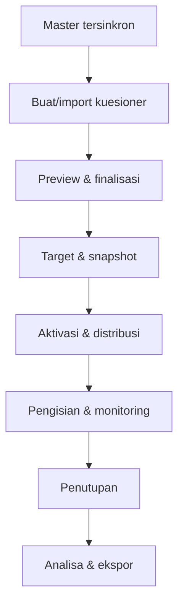

# Business Requirements Document (BRD)
## myAMETA Survey

**Versi:** 1.0  
**Tanggal:** 6 September 2026  
**Sponsor bisnis:** STIKES Advaita Medika  
**Pemilik proses:** Pengelola Survei/LPM  
**Platform implementasi:** Laravel Web Application  
**Status:** Baseline kebutuhan bisnis MVP  

---

## 1. Tujuan Dokumen

BRD ini mendefinisikan kebutuhan bisnis myAMETA Survey, proses yang harus didukung, ruang lingkup, stakeholder, aturan bisnis, data, kontrol, laporan, serta kriteria penerimaan. Detail perilaku layar, API, database, dan komponen Laravel diturunkan dalam FSD.

Versi ini secara tegas tidak mencakup PPEPP, temuan, RTL, PIC perbaikan, evidence, ataupun verifikasi perbaikan. Output bisnis berakhir pada **hasil analisa kuesioner berupa jumlah, persentase, grafik, komentar, filter, perbandingan, dan file laporan**.

---

## 2. Gambaran Kebutuhan Bisnis

Kampus membutuhkan satu aplikasi untuk:

1. memusatkan kuesioner;
2. menggunakan data mahasiswa dan pegawai yang telah tersedia;
3. menentukan responden secara terarah;
4. mengetahui progres pengisian;
5. mengurangi pengolahan manual;
6. menghasilkan grafik dan persentase otomatis;
7. menjaga integritas dan kerahasiaan jawaban;
8. tetap tersedia ketika ratusan mahasiswa login hampir bersamaan;
9. mengimpor template kuesioner agar instrumen dapat digunakan ulang.

---

## 3. Business Case

### 3.1 Kondisi saat ini

- survei dibuat pada berbagai platform;
- data responden diinput atau disalin manual;
- tautan didistribusikan tanpa kontrol eligibility yang konsisten;
- status pengisian dikompilasi manual;
- data diekspor lalu dihitung dengan rumus Excel;
- grafik dan laporan dibuat ulang untuk setiap survei;
- tidak ada kontrol baku agar struktur tidak berubah saat respons sudah masuk;
- akses serentak berpotensi mengganggu layanan.

### 3.2 Kondisi yang diharapkan

- proses survei berada pada satu aplikasi;
- mahasiswa/pegawai menggunakan SSO;
- master responden disinkronkan;
- kuesioner dapat dibuat dari template;
- target disimpan sebagai snapshot;
- respons dipantau real-time/near-real-time;
- analisa tersedia otomatis;
- laporan dapat diekspor;
- platform tetap stabil pada beban target tanpa load balancing.

### 3.3 Manfaat

| Area | Manfaat |
|---|---|
| Operasional | mengurangi duplikasi input dan pengolahan manual |
| Waktu | hasil tersedia segera setelah respons masuk/ditutup |
| Akurasi | rumus dan denominator konsisten |
| Tata kelola | status, versi, target, dan akses terdokumentasi |
| Pengalaman pengguna | login satu kali dan form mobile-friendly |
| Keamanan | akses berbasis role serta mode anonimitas jelas |
| Infrastruktur | single-server deployment lebih sederhana dan hemat |

---

## 4. Sasaran Bisnis

| ID | Sasaran | Ukuran awal |
|---|---|---|
| BG-01 | Seluruh proses survei pilot terpusat | 100% proses pilot di myAMETA Survey |
| BG-02 | Hasil otomatis | grafik dan persentase tersedia tanpa spreadsheet manual |
| BG-03 | Data responden akurat | sinkronisasi berhasil dan status terlihat |
| BG-04 | Partisipasi dapat dipantau | tersedia funnel eligible–mulai–selesai |
| BG-05 | Integritas jawaban | tidak ada perubahan struktur aktif/duplikasi respons |
| BG-06 | Hasil dapat disegmentasi | filter prodi, angkatan, unit, jenis responden |
| BG-07 | Layanan tahan peak | lulus uji ratusan sesi tanpa load balancer |

---

## 5. Ruang Lingkup

### 5.1 In-scope

- autentikasi SSO dan otorisasi;
- lima menu admin;
- sinkronisasi data mahasiswa dan pegawai;
- daftar, pencarian, filter, detail, dan status sinkronisasi;
- template dan impor template;
- builder kuesioner;
- tipe pertanyaan dasar dan branching section;
- preview/finalisasi;
- target/snapshot responden;
- aktivasi, jadwal, jeda, penutupan;
- daftar survei responden;
- save draft bila diaktifkan;
- submit idempotent;
- tracking dan reminder;
- hasil analisa, persentase, grafik, komentar, filter;
- XLSX, CSV, PDF, PNG;
- audit log, retensi dasar, monitoring, dan backup;
- performance hardening satu server.

### 5.2 Out-of-scope

- PPEPP, SPMI/AMI workflow;
- temuan, RTL, evidence, verifikasi;
- pengaduan/helpdesk;
- AI analytics;
- native mobile application;
- load balancer dan horizontal application scaling;
- WhatsApp pada MVP kecuali diputuskan melalui change request;
- statistik riset tingkat lanjut;
- external stakeholder selain yang disetujui untuk fase pertama.

---

## 6. Struktur Menu Bisnis

| No. | Menu | Tujuan |
|---:|---|---|
| 1 | Kuesioner | seluruh lifecycle kuesioner dan monitoring pengisian |
| 2 | Data Mahasiswa | memastikan master mahasiswa siap menjadi target |
| 3 | Data Pegawai | memastikan master dosen/tendik siap menjadi target |
| 4 | Hasil Analisa Kuesioner | membaca, memfilter, membandingkan, dan mengekspor hasil |
| 5 | Pengaturan | mengimpor dan mengelola template kuesioner |

Walaupun permintaan awal menyebut “empat menu”, daftar yang diberikan memuat lima menu. BRD menetapkan kelimanya sebagai baseline.

---

## 7. Stakeholder dan RACI

| Aktivitas | Sponsor/Pimpinan | LPM/Admin | Operator | IT Admin | Mahasiswa/Pegawai |
|---|---|---|---|---|---|
| Menetapkan tujuan survei | A | R | C | I | C |
| Membuat kuesioner | I | A | R | I | I |
| Menyetujui/finalisasi | I | A/R | C | I | I |
| Sinkron data | I | C | I | A/R | I |
| Menentukan target | I | A | R | C | I |
| Mengaktifkan/menutup | I | A/R | C | I | I |
| Mengisi survei | I | I | I | I | R |
| Melihat hasil | A/R | A/R | C | C | I |
| Mengelola template | I | A/R | C | C | I |
| Menjaga aplikasi | I | C | I | A/R | I |

R = Responsible, A = Accountable, C = Consulted, I = Informed.

---

## 8. Proses Bisnis Saat Ini dan Target

### 8.1 As-is

1. Unit menyusun pertanyaan di dokumen/form.
2. Data responden dipilih manual.
3. Tautan dibagikan melalui grup atau pesan.
4. Respons terkumpul tanpa dashboard target lengkap.
5. Admin mengekspor ke Excel.
6. Persentase dan grafik dihitung manual.
7. File laporan disimpan terpisah.

### 8.2 To-be

### 8.3 Exception flow

- Sync gagal: data aktif sebelumnya tetap tersedia dan admin melihat error.
- Target kosong: aktivasi ditolak.
- Kuesioner belum valid: finalisasi ditolak dengan daftar masalah.
- SSO gagal: pengguna mendapat pesan dan correlation ID.
- Tidak eligible: akses form ditolak tanpa membocorkan target.
- Campaign dijeda/berakhir: form tidak menerima respons baru.
- Submit berulang: hasil pertama yang valid dipertahankan dan respons kedua tidak dibuat.
- Ekspor besar: permintaan masuk antrean dan pengguna mendapat notifikasi saat siap.
- Import template salah: tidak ada data parsial yang disimpan.

---

## 9. Business Requirements

### 9.1 Akses dan pengguna

| ID | Kebutuhan bisnis | Prioritas |
|---|---|---|
| BR-AU-001 | Pengguna masuk melalui SSO Portal Hub | Must |
| BR-AU-002 | Sistem menentukan role dan scope setelah login | Must |
| BR-AU-003 | Mahasiswa/pegawai hanya melihat survei yang ditujukan kepadanya | Must |
| BR-AU-004 | Admin hanya mengakses menu/aksi sesuai role | Must |
| BR-AU-005 | Aksi sensitif dicatat dalam audit log | Must |
| BR-AU-006 | Logout mengakhiri session aplikasi dengan aman | Must |
| BR-AU-007 | Sistem tidak memanggil API master penuh pada setiap login | Must |

### 9.2 Menu Kuesioner

| ID | Kebutuhan bisnis | Prioritas |
|---|---|---|
| BR-QU-001 | Daftar kuesioner dipisah menurut status | Must |
| BR-QU-002 | Admin membuat kuesioner kosong atau dari template | Must |
| BR-QU-003 | Kuesioner memiliki metadata, section, pertanyaan, opsi, dan urutan | Must |
| BR-QU-004 | Builder mendukung tipe pertanyaan MVP | Must |
| BR-QU-005 | Admin mengatur pertanyaan wajib/opsional dan Tidak Relevan | Must |
| BR-QU-006 | Sistem mendukung branching berbasis section | Must |
| BR-QU-007 | Admin dapat preview sebelum finalisasi | Must |
| BR-QU-008 | Sistem memvalidasi kelengkapan struktur | Must |
| BR-QU-009 | Finalisasi mengunci struktur | Must |
| BR-QU-010 | Admin dapat menduplikasi tanpa membawa respons | Must |
| BR-QU-011 | Admin memilih target dan melihat jumlah eligible | Must |
| BR-QU-012 | Sistem menyimpan audience snapshot ketika aktif | Must |
| BR-QU-013 | Admin menjadwalkan, mengaktifkan, menjeda, dan menutup | Must |
| BR-QU-014 | Admin memantau target, mulai, selesai, gagal kirim | Must |
| BR-QU-015 | Reminder hanya ditujukan kepada responden belum selesai | Must |

### 9.3 Menu Data Mahasiswa

| ID | Kebutuhan bisnis | Prioritas |
|---|---|---|
| BR-DM-001 | Menampilkan mahasiswa hasil sinkronisasi | Must |
| BR-DM-002 | Mencari NIM/nama | Must |
| BR-DM-003 | Filter prodi, jenjang, angkatan, tahun masuk, dan status | Must |
| BR-DM-004 | Menampilkan last sync dan sumber data | Must |
| BR-DM-005 | Admin berwenang dapat memulai sync | Must |
| BR-DM-006 | Menampilkan jumlah berhasil/gagal/bermasalah | Must |
| BR-DM-007 | Data tidak dihapus hanya karena satu sync gagal | Must |
| BR-DM-008 | Impor XLSX fallback tersedia bila disetujui | Should |
| BR-DM-009 | Ekspor data dibatasi kewenangan | Should |

### 9.4 Menu Data Pegawai

| ID | Kebutuhan bisnis | Prioritas |
|---|---|---|
| BR-DP-001 | Menampilkan dosen dan tenaga kependidikan | Must |
| BR-DP-002 | Mencari NIP/kode/nama | Must |
| BR-DP-003 | Filter jenis pegawai, unit, jabatan, dan status | Must |
| BR-DP-004 | Menampilkan last sync dan sumber data | Must |
| BR-DP-005 | Admin berwenang dapat memulai sync | Must |
| BR-DP-006 | Menampilkan jumlah berhasil/gagal/bermasalah | Must |
| BR-DP-007 | Data tidak dihapus hanya karena satu sync gagal | Must |
| BR-DP-008 | Impor XLSX fallback tersedia bila disetujui | Should |

### 9.5 Pengisian responden

| ID | Kebutuhan bisnis | Prioritas |
|---|---|---|
| BR-RS-001 | Responden melihat daftar survei eligible dan status | Must |
| BR-RS-002 | Tujuan, periode, durasi, dan mode identitas terlihat sebelum mulai | Must |
| BR-RS-003 | Form berfungsi pada ponsel dan desktop | Must |
| BR-RS-004 | Pertanyaan tampil sesuai branching | Must |
| BR-RS-005 | Sistem memberi validasi yang mudah dipahami | Must |
| BR-RS-006 | Draft dapat disimpan jika campaign mengizinkan | Should |
| BR-RS-007 | Submit tidak dapat menghasilkan respons ganda | Must |
| BR-RS-008 | Responden mendapat konfirmasi selesai | Must |
| BR-RS-009 | Responden tidak dapat mengubah jawaban setelah submit kecuali kebijakan mengizinkan reopen | Must |

### 9.6 Menu Hasil Analisa

| ID | Kebutuhan bisnis | Prioritas |
|---|---|---|
| BR-HA-001 | Menampilkan daftar survei yang memiliki respons | Must |
| BR-HA-002 | Menampilkan populasi/eligible/mulai/selesai/response rate | Must |
| BR-HA-003 | Menghitung jumlah dan persentase per opsi | Must |
| BR-HA-004 | Memilih grafik sesuai tipe pertanyaan | Must |
| BR-HA-005 | Menampilkan mean/median untuk skala/angka | Must |
| BR-HA-006 | Memfilter hasil menurut atribut responden | Must |
| BR-HA-007 | Menampilkan `n`, denominator, filter, dan periode | Must |
| BR-HA-008 | Tidak Relevan tidak masuk denominator skor | Must |
| BR-HA-009 | Multiple choice menjelaskan total persentase dapat >100% | Must |
| BR-HA-010 | Menyembunyikan hasil segmen di bawah threshold | Must |
| BR-HA-011 | Menampilkan jawaban teks sesuai hak akses | Must |
| BR-HA-012 | Mengekspor XLSX/CSV/PDF dan PNG | Must |
| BR-HA-013 | Ekspor besar berjalan asynchronous | Must |
| BR-HA-014 | Membandingkan segmen/periode kompatibel | Should |

### 9.7 Menu Pengaturan – Impor Template

| ID | Kebutuhan bisnis | Prioritas |
|---|---|---|
| BR-TP-001 | Pengguna mengunduh contoh XLSX | Must |
| BR-TP-002 | Sistem menerima XLSX dan JSON sesuai schema | Must |
| BR-TP-003 | Sistem memvalidasi sebelum penyimpanan | Must |
| BR-TP-004 | Pengguna melihat preview dan error rinci | Must |
| BR-TP-005 | Pengguna mengonfirmasi commit | Must |
| BR-TP-006 | Impor bersifat all-or-nothing | Must |
| BR-TP-007 | Sistem menyimpan histori dan pengimpor | Must |
| BR-TP-008 | Template dapat diaktifkan/nonaktifkan | Must |
| BR-TP-009 | Template yang telah digunakan tidak boleh dihapus secara merusak | Must |
| BR-TP-010 | Template dapat diekspor | Should |

### 9.8 Kinerja, operasi, dan keamanan

| ID | Kebutuhan bisnis | Prioritas |
|---|---|---|
| BR-NF-001 | Framework backend wajib Laravel | Must |
| BR-NF-002 | Sistem beroperasi pada satu application server tanpa load balancing | Must |
| BR-NF-003 | Sistem mendukung minimal 500 sesi aktif sesuai uji beban | Must |
| BR-NF-004 | Login burst tidak memicu full sync/API master per pengguna | Must |
| BR-NF-005 | Email, impor, ekspor, dan agregasi berat memakai queue | Must |
| BR-NF-006 | Session/cache/queue menggunakan Redis | Must |
| BR-NF-007 | Database menggunakan PostgreSQL dan indeks yang sesuai | Must |
| BR-NF-008 | Backup dan prosedur restore tersedia | Must |
| BR-NF-009 | Monitoring, error tracking, dan health check tersedia | Must |
| BR-NF-010 | Data transit dilindungi TLS dan akses mengikuti least privilege | Must |

---

## 10. Business Rules

### 10.1 Kuesioner

| ID | Aturan |
|---|---|
| RULE-Q01 | Hanya Draft yang dapat mengubah struktur. |
| RULE-Q02 | Kuesioner harus memiliki minimal satu section dan satu pertanyaan valid. |
| RULE-Q03 | Kode pertanyaan unik dalam satu kuesioner. |
| RULE-Q04 | Pertanyaan pilihan harus memiliki opsi minimum sesuai tipe. |
| RULE-Q05 | Branch target harus mengarah ke section valid dan tidak membentuk loop tanpa akhir. |
| RULE-Q06 | Finalisasi gagal jika validasi struktur gagal. |
| RULE-Q07 | Kuesioner aktif/ditutup hanya dapat dijadikan sumber duplikasi. |
| RULE-Q08 | Menghapus kuesioner hanya diizinkan pada Draft tanpa dependensi; selain itu archive/soft delete. |

### 10.2 Target dan campaign

| ID | Aturan |
|---|---|
| RULE-C01 | Campaign tidak aktif bila target eligible nol. |
| RULE-C02 | Tanggal selesai harus setelah tanggal mulai. |
| RULE-C03 | Audience snapshot tidak berubah setelah aktivasi. |
| RULE-C04 | Perubahan data master setelah aktivasi tidak mengubah denominator campaign lama. |
| RULE-C05 | Hanya satu eligibility aktif per responden per campaign. |
| RULE-C06 | Reminder hanya untuk status belum selesai dan tidak melewati waktu berakhir. |
| RULE-C07 | Campaign ditutup tidak menerima respons baru. |
| RULE-C08 | Admin dapat jeda tanpa menghapus jawaban yang sudah ada. |

### 10.3 Respons

| ID | Aturan |
|---|---|
| RULE-R01 | Jawaban wajib harus terisi sebelum submit. |
| RULE-R02 | Jawaban harus sesuai tipe, opsi, range, dan versi kuesioner. |
| RULE-R03 | Submit pertama yang valid bersifat final kecuali reopen resmi. |
| RULE-R04 | Idempotency key yang sama mengembalikan hasil yang sama, bukan membuat respons baru. |
| RULE-R05 | Verified anonymous tidak menyimpan foreign key identitas pada payload respons. |
| RULE-R06 | Autosave bukan respons selesai dan tidak masuk hasil final. |
| RULE-R07 | Respons test tidak masuk laporan produksi. |

### 10.4 Analitik

| ID | Aturan |
|---|---|
| RULE-A01 | Persentase single choice memakai jawaban valid sebagai denominator. |
| RULE-A02 | Multiple choice memakai jumlah responden valid sebagai denominator per opsi. |
| RULE-A03 | Tidak Relevan dilaporkan terpisah dan dikeluarkan dari skor. |
| RULE-A04 | Pertanyaan tidak terjawab tidak dianggap nilai nol. |
| RULE-A05 | Hasil selalu menampilkan `n` dan filter aktif. |
| RULE-A06 | Segmen di bawah threshold tidak ditampilkan. |
| RULE-A07 | Hasil antarperiode hanya dibandingkan jika item/skala kompatibel. |
| RULE-A08 | Pembulatan tampilan tidak mengubah nilai sumber; default dua desimal pada laporan detail. |

### 10.5 Template dan data master

| ID | Aturan |
|---|---|
| RULE-T01 | Import template divalidasi sebelum commit. |
| RULE-T02 | Satu error struktural membatalkan seluruh commit. |
| RULE-T03 | Template terpakai tidak dihapus fisik; hanya dinonaktifkan. |
| RULE-D01 | Identifier dari sistem sumber menjadi kunci rekonsiliasi. |
| RULE-D02 | Sync gagal tidak menonaktifkan seluruh master. |
| RULE-D03 | Perubahan penting tercatat dengan timestamp dan source. |

---

## 11. Data Requirements dan Ownership

| Data | Owner/source | Penggunaan | Retensi awal |
|---|---|---|---|
| Akun/role | Portal Hub | login dan otorisasi | cache selama aktif |
| Mahasiswa | Portal Hub/SIAKAD | target dan filter | sesuai kebijakan master |
| Pegawai | Portal Hub/HRIS | target dan filter | sesuai kebijakan master |
| Kuesioner/template | myAMETA Survey | pengumpulan data | selama dibutuhkan/histori |
| Audience snapshot | myAMETA Survey | denominator dan tracking | minimal sepanjang laporan |
| Draft jawaban | myAMETA Survey | resume pengisian | sampai submit/expiry |
| Respons final | myAMETA Survey | analitik/laporan | ditetapkan kampus |
| File ekspor | myAMETA Survey | unduh sementara | pendek, mis. 24–72 jam |
| Audit log | myAMETA Survey | pemeriksaan keamanan | minimal 1 tahun atau kebijakan |

Retensi final, lawful basis, dan hak akses harus disahkan oleh kampus sebelum produksi.

Untuk mode verified anonymous, respons dapat menyimpan snapshot atribut kategorikal yang dibutuhkan untuk analisis—misalnya prodi, angkatan, jenis responden, atau unit—tetapi tidak menyimpan NIM, NIP, nama, email, source ID, atau foreign key yang dapat langsung menghubungkan jawaban ke orang tertentu. Hasil tetap tunduk pada minimum segment size.

### 11.1 Atribut minimum mahasiswa

- hub_id/source_id;
- NIM;
- nama;
- email institusi;
- prodi, fakultas, jenjang;
- angkatan/tahun masuk;
- status;
- last_synced_at.

### 11.2 Atribut minimum pegawai

- hub_id/source_id;
- NIP/kode pegawai;
- nama;
- email institusi;
- jenis: dosen/tendik;
- unit;
- jabatan opsional untuk targeting terbatas;
- status;
- last_synced_at.

---

## 12. Matriks Akses Bisnis

| Kapabilitas | LPM Admin | Operator | Pimpinan | IT Admin | Responden |
|---|---:|---:|---:|---:|---:|
| Kelola kuesioner | penuh | draft/operasional | lihat | tidak/default | tidak |
| Finalisasi/aktifkan/tutup | ya | sesuai delegasi | tidak | tidak | tidak |
| Data mahasiswa/pegawai | sesuai scope | terbatas | agregat | teknis | diri sendiri |
| Sync data | opsional | tidak | tidak | ya | tidak |
| Monitoring pengisian | ya | ya | ringkas | health only | status diri |
| Hasil agregat | ya | sesuai scope | ya | tidak/default | tidak |
| Komentar mentah | role khusus | tidak/default | tidak/default | tidak | tidak |
| Raw export | role khusus | tidak | tidak/default | tidak | tidak |
| Import template | ya | sesuai delegasi | tidak | dukungan teknis | tidak |
| Audit teknis | terbatas | tidak | tidak | ya | tidak |

---

## 13. Reporting Requirements

### 13.1 Dashboard monitoring

- jumlah eligible;
- jumlah invitation;
- delivered/failed bila kanal mendukung;
- belum mulai;
- mulai/belum selesai;
- selesai;
- response rate;
- completion rate;
- distribusi per prodi/angkatan/unit dengan threshold.

### 13.2 Dashboard hasil

- identitas kuesioner, status, periode;
- active filter dan jumlah `n`;
- ringkasan respons;
- jumlah/persentase per opsi;
- mean/median pada skala/angka;
- grafik sesuai tipe;
- tabel komentar;
- perbandingan segmen/periode jika kompatibel;
- timestamp terakhir agregasi.

### 13.3 File laporan

- XLSX: sheet metadata, response summary, per-question result, dan raw/pseudonymized sesuai hak;
- CSV: dataset yang dipilih;
- PDF: sampul, metadata, responden, grafik, tabel, catatan denominator;
- PNG: grafik tunggal dengan judul, filter, `n`, dan sumber waktu.

---

## 14. Nonfunctional Business Requirements

### 14.1 Kapasitas tanpa load balancing

Baseline penerimaan:

- 500 sesi aktif bersamaan;
- 300 callback login dalam 60 detik;
- 200 pembukaan form bersamaan;
- 100 submit bersamaan;
- error aplikasi <1%;
- tidak ada respons ganda;
- P95 API interaktif ≤1,5 detik di luar ketergantungan eksternal;
- P95 submit ≤2 detik;
- dashboard umum P95 ≤3 detik;
- pekerjaan berat tidak memblokir request web.

Pencapaian dilakukan pada satu application server melalui Redis, OPcache, tuning PHP-FPM/Nginx, connection pooling, query/index, caching, queue worker, dan pre-aggregation.

### 14.2 Availability dan recovery

- target availability periode survei minimal 99,5%, kecuali maintenance terjadwal;
- backup database harian dan incremental/continuous sesuai infrastruktur;
- restore drill sebelum go-live besar;
- RPO awal maksimal 24 jam, target lebih baik bila PITR tersedia;
- RTO awal maksimal 4 jam;
- maintenance dikomunikasikan di luar jam pengisian utama.

### 14.3 Keamanan dan privasi

- TLS;
- RBAC dan organizational scope;
- audit log;
- secure session;
- protection terhadap OWASP Top 10;
- batas upload dan pemeriksaan file;
- enkripsi backup;
- pemisahan identity/response untuk verified anonymous;
- threshold kelompok kecil;
- data minimization dan retensi.

### 14.4 Usability dan aksesibilitas

- responsive mobile-first;
- navigasi keyboard;
- label screen reader;
- error jelas;
- kontras memadai;
- indikator progres;
- autosave/recovery untuk survei panjang;
- bahasa Indonesia yang mudah dipahami.

---

## 15. Integrasi Bisnis

| Integrasi | Arah | Data/fungsi | Kritis |
|---|---|---|---:|
| Portal Hub SSO | masuk | identitas, role, session assertion | ya |
| Portal Hub/SIAKAD | masuk | mahasiswa, prodi, angkatan, status | ya |
| Portal Hub/HRIS | masuk | pegawai, unit, jenis, status | ya |
| Portal Hub task center | dua arah/keluar | daftar tugas survei dan status selesai | ya/opsional sesuai API |
| SMTP | keluar | undangan dan reminder | opsional MVP |
| Object storage | keluar/masuk | file impor/ekspor | ya |

Integrasi master harus dilakukan terjadwal atau melalui webhook. Login tidak boleh bergantung pada full fetch data sumber.

---

## 16. Assumptions, Constraints, dan Dependencies

### Asumsi

- identifier Portal Hub stabil;
- data prodi/unit tersedia;
- mahasiswa dan pegawai memiliki akun SSO;
- tim kampus menyediakan template dan contoh laporan;
- timezone institusi dikonfigurasi.

### Constraints

- framework Laravel;
- satu application server;
- tanpa load balancing pada versi awal;
- lima menu utama tidak ditambah tanpa change control;
- output berhenti pada hasil analisa;
- sumber daya server menentukan kapasitas aktual.

### Dependencies

- kesiapan SSO dan API;
- PostgreSQL dan Redis;
- domain/TLS;
- SMTP jika email;
- keputusan mode identitas dan retensi;
- persetujuan format import template.

---

## 17. Risiko Bisnis

| Risiko | Dampak | Mitigasi | Owner |
|---|---|---|---|
| Data sumber tidak lengkap | targeting salah | mapping, reconciliation, laporan invalid data | IT/Data Owner |
| SSO terganggu saat peak | pengguna gagal masuk | cache/JIT minimal, retry aman, status page | IT |
| Server undersized | lambat/down | capacity test, tuning, vertical upgrade | IT/Manajemen |
| Survei terlalu panjang | drop-off | estimasi durasi, preview, branching | LPM |
| Struktur berubah | laporan tidak konsisten | lock dan version/duplicate | LPM |
| Identitas anonim bocor | kehilangan kepercayaan | separation, threshold, audit | IT/LPM |
| Rumus salah | keputusan salah | definisi, unit test, golden dataset | Product/QA |
| Template impor salah | konfigurasi rusak | schema validation dan transaction | Operator/IT |
| Scope creep PPEPP | proyek terlambat | non-goals dan change request | Sponsor/Product |

---

## 18. UAT dan Business Acceptance

### 18.1 Kelompok penguji

- Admin LPM;
- operator survei;
- pimpinan/viewer;
- IT administrator;
- mahasiswa lintas prodi/angkatan;
- dosen dan tenaga kependidikan;
- QA.

### 18.2 Skenario minimum

1. SSO semua role.
2. Sync mahasiswa dan pegawai, termasuk data invalid serta sync gagal.
3. Import template valid/invalid.
4. Buat dari nol dan template.
5. Semua tipe pertanyaan dan branching.
6. Preview/finalisasi/lock.
7. Target filter dan snapshot.
8. Aktivasi/jeda/tutup.
9. Form mobile, autosave, validasi, submit.
10. Duplicate submit dan refresh setelah submit.
11. Monitoring dan reminder.
12. Perhitungan persentase golden dataset.
13. Filter dan threshold.
14. Komentar dan akses role.
15. XLSX/CSV/PDF/PNG.
16. Load, spike, soak, dan recovery test.
17. Audit log dan akses terlarang.
18. Backup/restore drill.

### 18.3 Kriteria persetujuan

- seluruh Must requirement lulus;
- tidak ada defect severity critical/high yang terbuka;
- rumus lolos golden dataset;
- tidak ada duplikasi respons pada concurrency test;
- performance baseline tercapai pada server yang disepakati;
- privacy/permission test lulus;
- SOP operasional dan fallback disetujui;
- berita acara UAT ditandatangani.

---

## 19. Traceability ke Dokumen Lanjutan

- PRD menerjemahkan BR menjadi pengalaman, prioritas, dan outcome produk.
- FSD wajib memetakan setiap `BR-*` ke fitur, endpoint, database, aturan validasi, serta test case.
- Perubahan terhadap in-scope/out-of-scope menggunakan change request dengan dampak biaya, waktu, risiko, dan arsitektur.

---

## 20. Open Decisions

1. Satu tenant atau kesiapan multi-tenant sejak awal.
2. Detail IdP/SSO dan claims.
3. API authoritative mahasiswa/pegawai.
4. Portal task center atau hanya tautan aplikasi.
5. Email masuk MVP atau fase berikutnya.
6. XLSX saja atau XLSX+JSON untuk template.
7. Public link/QR masuk MVP atau tidak.
8. Nilai threshold default.
9. Hak raw export dan komentar.
10. Kebijakan reopen respons.
11. Template awal wajib.
12. Spesifikasi server dan target volume tahunan.
13. Retensi respons, draft, audit, dan ekspor.
14. Format branding laporan.
