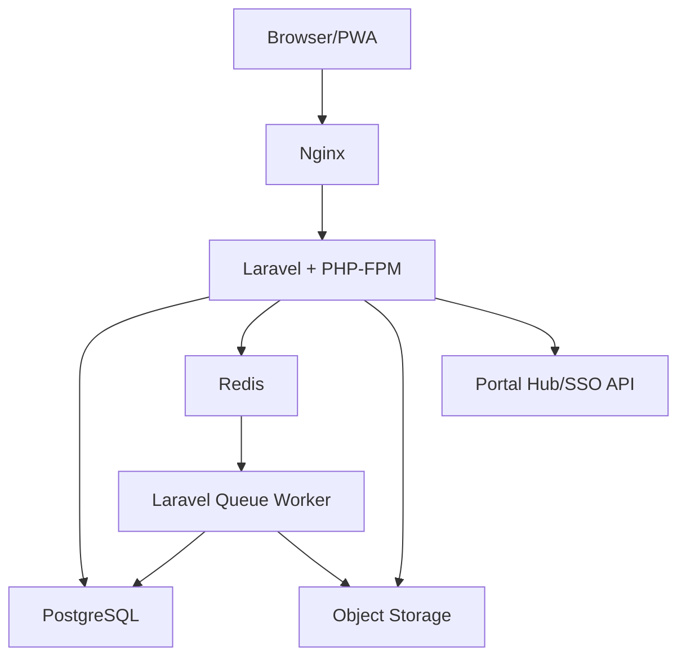
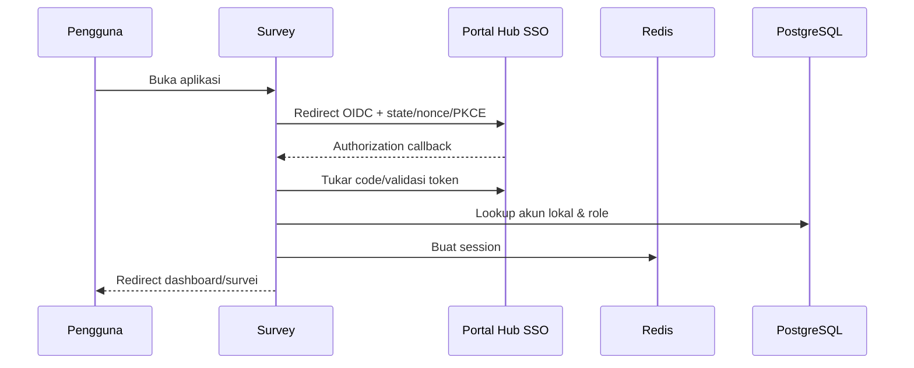

# Functional Specification Document (FSD)
## myAMETA Survey — Implementasi Laravel

**Versi:** 1.0  
**Tanggal:** 6 September 2026  
**Framework wajib:** Laravel  
**Arsitektur deployment MVP:** Satu application server, tanpa load balancing  
**Database:** PostgreSQL  
**Session, cache, dan queue:** Redis  
**Status:** Baseline teknis dan fungsional pengembangan  

---

## 1. Tujuan dan Batas Dokumen

FSD ini menerjemahkan PRD dan BRD myAMETA Survey menjadi spesifikasi yang dapat diimplementasikan, diuji, dan diterima. Dokumen meliputi:

- arsitektur Laravel;
- navigasi lima menu;
- alur autentikasi dan responden;
- lifecycle kuesioner;
- kebutuhan layar dan aksi;
- model database;
- API dan integrasi;
- aturan validasi;
- kalkulasi analitik dan grafik;
- impor template;
- queue, scheduler, cache, concurrency, dan idempotency;
- keamanan, privasi, audit, observability, backup;
- performance test tanpa load balancing;
- test strategy dan deployment.

Tidak ada modul PPEPP, temuan, RTL, PIC, evidence, atau verifikasi tindakan.

---

## 2. Terminologi

| Istilah | Definisi |
|---|---|
| Kuesioner | Struktur pertanyaan yang akan dijalankan sebagai satu survei |
| Template | Struktur reusable yang di-clone menjadi kuesioner Draft |
| Section | Bagian/halaman logis di dalam kuesioner |
| Pertanyaan | Satu item input pada section |
| Campaign | Konfigurasi pelaksanaan kuesioner: target, jadwal, mode, dan kanal |
| Audience snapshot | Salinan final target pada saat aktivasi |
| Eligibility | Hak satu subjek untuk mengisi satu campaign |
| Response session | Proses pengisian yang belum tentu selesai |
| Response | Submission final |
| Identified | Jawaban dapat dihubungkan dengan responden |
| Verified anonymous | Eligibility diketahui tetapi respons final tidak memiliki relasi langsung ke identitas |
| Valid answer | Jawaban yang sesuai schema dan dipakai pada denominator terkait |
| Tidak Relevan | Pilihan khusus yang dilaporkan terpisah dan tidak masuk skor |

---

## 3. Arsitektur Sistem

### 3.1 Logical architecture



### 3.2 Architectural style

Gunakan **modular monolith**. Seluruh fitur berada dalam satu repository dan deployment unit, tetapi domain dipisahkan agar tidak menjadi satu kumpulan controller/model tanpa batas.

Struktur konseptual:

```text
app/
├── Domains/
│   ├── Identity/
│   ├── Students/
│   ├── Employees/
│   ├── Questionnaires/
│   ├── Templates/
│   ├── Campaigns/
│   ├── Responses/
│   ├── Analytics/
│   ├── Exports/
│   ├── Integrations/
│   └── Audit/
├── Http/
│   ├── Controllers/
│   ├── Middleware/
│   ├── Requests/
│   └── Resources/
├── Jobs/
├── Events/
├── Listeners/
├── Policies/
└── Support/
```

Setiap domain minimal memiliki Actions/Services, DTO, Models, Policies, dan Tests. Controller hanya menangani HTTP orchestration; aturan bisnis tidak diletakkan di controller atau Blade component.

### 3.3 Technology baseline

- Laravel versi stabil yang masih didukung saat implementasi;
- PHP versi yang didukung Laravel tersebut;
- PostgreSQL;
- Redis untuk session, cache, queue, atomic lock, dan rate limiting;
- Nginx + PHP-FPM;
- PHP OPcache aktif;
- Laravel Horizon bila kompatibel dan disetujui untuk observasi queue;
- Laravel Scheduler dijalankan melalui cron/system service;
- object storage S3-compatible atau filesystem privat untuk file;
- frontend: Blade + Livewire/Alpine atau SPA framework sesuai keputusan tim, tanpa mengubah kontrak API/domain;
- chart library yang mendukung bar, donut, stacked bar, line, heatmap, dan ekspor gambar;
- XLSX library yang mendukung streaming/chunk read/write.

Versi paket dikunci melalui lockfile dan diperbarui dengan proses review.

---

## 4. Deployment Satu Server Tanpa Load Balancing

### 4.1 Komponen server

Satu server menjalankan:

- Nginx;
- PHP-FPM application workers;
- queue workers;
- scheduler;
- Redis;
- PostgreSQL bila belum dipisah;
- monitoring agent.

Jika anggaran memungkinkan, database/object storage boleh berada pada layanan terpisah tanpa menjadikan application layer menggunakan load balancing. Deployment awal tetap satu application node.

### 4.2 Strategi ketahanan

1. **Pre-synchronized roster:** data mahasiswa/pegawai sudah lokal sebelum peak.
2. **No full API fetch on login:** callback SSO hanya memvalidasi token/claim dan lookup lokal.
3. **Redis session:** request login tidak menulis session ke filesystem.
4. **Redis cache:** menu, role mapping, kuesioner aktif, dan metadata aman di-cache.
5. **PHP OPcache:** mengurangi parsing/compilation pada request.
6. **PHP-FPM tuning:** `pm.max_children`, spare servers, request timeout, dan recycle disesuaikan RAM serta hasil load test.
7. **DB indexes dan pooling:** query login, eligibility, serta form menggunakan indeks; PgBouncer transaction pooling dapat dipakai bila sesuai.
8. **Queue:** email, export, import commit besar, dan agregasi tidak dijalankan pada request web.
9. **Pre-aggregation:** hasil umum disiapkan/cache dan di-invalidasi secara terkontrol.
10. **Idempotency:** submit dan webhook aman terhadap retry.
11. **Circuit breaker/timeouts:** gangguan API/SMTP tidak menghabiskan PHP workers.
12. **Backpressure:** batas concurrency export/import dan rate limit public endpoints.

### 4.3 Capacity baseline

- 500 active authenticated sessions;
- burst 300 SSO callbacks/60 detik;
- 200 questionnaire opens bersamaan;
- 100 concurrent submissions;
- 50 admin analysis requests dengan cache;
- error rate aplikasi <1%;
- tidak ada duplicate final response;
- tidak ada data loss;
- P95 API interaktif ≤1,5 detik di luar IdP;
- P95 submit ≤2 detik;
- P95 dashboard cached/common ≤3 detik.

Spesifikasi ini bukan jaminan tanpa uji. Kapasitas disahkan melalui load test pada server produksi-equivalent.

### 4.4 Sizing awal satu server

Sizing berikut merupakan titik awal, bukan pengganti load test:

- **minimum untuk staging/pilot ringan:** 4 vCPU, 8 GB RAM, SSD/NVMe;
- **baseline produksi untuk target 500 sesi aktif jika web, Redis, worker, dan PostgreSQL berada pada server yang sama:** 8 vCPU, 16 GB RAM, NVMe minimal 100 GB;
- ruang disk harus memperhitungkan database, WAL/log, file sementara ekspor, backup lokal sementara, dan pertumbuhan respons;
- swap hanya menjadi pengaman, bukan kapasitas utama;
- resource limit queue worker dipisahkan agar tidak mengambil seluruh CPU/RAM dari PHP-FPM;
- `pm.max_children` dihitung dari RAM yang dialokasikan dibagi konsumsi rata-rata proses PHP hasil pengukuran, bukan angka salinan;
- koneksi PostgreSQL dibatasi dan dipool; jangan menyamakan jumlah user dengan jumlah koneksi database;
- slow query log, OPcache hit rate, Redis eviction, PHP-FPM saturation, serta queue wait menjadi dasar tuning.

Jika hasil load test gagal setelah optimasi query/cache/tuning, langkah berikutnya adalah vertical scaling. Load balancing tetap tidak digunakan pada MVP.

---

## 5. Autentikasi, Session, dan Otorisasi

### 5.1 SSO flow



Persyaratan:

- Authorization Code Flow dengan PKCE bila didukung;
- verifikasi issuer, audience, signature, expiry, state, dan nonce;
- timeout koneksi pendek dan retry terbatas;
- correlation ID pada error;
- JIT create/update akun hanya untuk atribut minimum;
- full student/employee sync tidak dilakukan di callback;
- session ID diregenerasi setelah login;
- cookie `Secure`, `HttpOnly`, dan `SameSite` sesuai flow;
- session disimpan di Redis dengan TTL;
- logout lokal tersedia; federated logout mengikuti kemampuan IdP.

### 5.2 Roles

- `lpm_admin`;
- `survey_operator`;
- `executive_viewer`;
- `technical_admin`;
- `student_respondent`;
- `employee_respondent`;
- `raw_data_analyst` opsional dan sangat terbatas.

### 5.3 Authorization

Gunakan Laravel Policies/Gates. Pemeriksaan role saja tidak cukup; setiap resource juga memeriksa `tenant_id` dan scope organisasi jika berlaku.

| Aksi | LPM Admin | Operator | Viewer | Technical Admin | Responden |
|---|---:|---:|---:|---:|---:|
| Kelola Draft | ya | ya | tidak | tidak | tidak |
| Finalisasi/aktifkan/tutup | ya | delegated | tidak | tidak | tidak |
| Sync master | opsional | tidak | tidak | ya | tidak |
| Lihat data identitas | ya terbatas | terbatas | agregat | teknis terbatas | diri |
| Lihat hasil agregat | ya | scope | ya | tidak/default | tidak |
| Raw export/komentar | role khusus | tidak | tidak/default | tidak | tidak |
| Import template | ya | delegated | tidak | support | tidak |
| Isi survei | tidak | tidak | tidak | tidak | eligible only |

---

## 6. Navigasi dan Routing

### 6.1 Admin layout

Sidebar final:

1. `/questionnaires` — Kuesioner;
2. `/students` — Data Mahasiswa;
3. `/employees` — Data Pegawai;
4. `/analytics` — Hasil Analisa Kuesioner;
5. `/settings/templates` — Pengaturan/Import Template Kuesioner.

Topbar menampilkan institusi, pengguna, role aktif, notifikasi job, dan logout.

### 6.2 Respondent routes

- `/my-surveys`;
- `/my-surveys/{eligibility}`;
- `/responses/{session}/section/{section}`;
- `/responses/{session}/review`;
- `/responses/{session}/completed`.

Responden tidak melihat sidebar admin.

---

## 7. Modul Kuesioner

### 7.1 Halaman daftar

Komponen:

- tab Draft, Siap Disebarkan, Aktif, Dijeda, Ditutup;
- search judul/kode;
- filter kategori, target, pembuat, tanggal, periode;
- sort updated/created/start/end/title;
- pagination server-side;
- tombol Buat Kuesioner;
- aksi kontekstual per status.

Kolom:

- kode;
- judul;
- target;
- status;
- periode;
- tanggal aktif–selesai;
- jumlah target;
- selesai/response rate untuk aktif/ditutup;
- pembuat;
- updated_at;
- actions.

Empty, loading, error, unauthorized, dan no-result state wajib tersedia.

### 7.2 Membuat kuesioner

Langkah:

1. pilih Template Kosong atau template aktif;
2. isi metadata;
3. sistem membuat Draft dan clone struktur template;
4. masuk builder.

Metadata:

- kode otomatis dan unique;
- judul (wajib, maks. 200 karakter);
- deskripsi/tujuan;
- kategori;
- audience type: mahasiswa, pegawai, keduanya;
- periode akademik opsional;
- estimasi durasi opsional/hasil hitung;
- mode identitas: identified atau verified anonymous;
- allow draft save;
- confirmation text;
- privacy notice.

### 7.3 Builder

Layout:

- sidebar section;
- canvas pertanyaan;
- toolbar preview, validasi, simpan, finalisasi;
- panel properti pertanyaan/section.

Fungsi section:

- tambah;
- rename;
- deskripsi;
- reorder;
- duplicate;
- delete jika aman;
- tandai first/default;
- atur completion behavior.

Fungsi pertanyaan:

- tambah;
- edit teks/help text;
- kode unique;
- pilih tipe;
- required;
- allow not applicable;
- validation/range;
- options;
- reorder;
- duplicate;
- delete;
- branch target untuk choice;
- chart preference opsional.

Tipe MVP:

| Code | Tipe | Stored value |
|---|---|---|
| `short_text` | teks pendek | string |
| `long_text` | teks panjang | text |
| `single_choice` | pilihan tunggal | option UUID |
| `multiple_choice` | pilihan ganda | array option UUID |
| `dropdown` | dropdown | option UUID |
| `likert` | skala | numeric code + option UUID |
| `matrix` | matriks | map row UUID → option UUID/value |
| `number` | angka | decimal |
| `date` | tanggal | ISO date |

### 7.4 Branching engine

MVP menggunakan pilihan → target section.

Validasi:

- target section harus berada pada kuesioner yang sama;
- target tidak boleh section saat ini;
- graph tidak boleh mempunyai cycle tak berujung;
- section default berikutnya digunakan jika tidak ada rule;
- branch rule disimpan pada snapshot;
- server memvalidasi bahwa jawaban hanya berasal dari section yang reachable.

### 7.5 Preview dan validation report

Preview modes:

- mobile width;
- desktop width;
- branch simulator;
- test response.

Validation errors:

- metadata wajib kosong;
- tidak ada section/pertanyaan;
- kode duplikat;
- option kosong/duplikat tidak diizinkan;
- question choice tanpa opsi;
- matrix tanpa row/scale;
- branch target invalid;
- unreachable section;
- required consent/privacy notice yang diperlukan tidak ada.

Warning tidak harus memblokir, misalnya pertanyaan panjang atau estimasi >15 menit. Error memblokir finalisasi.

### 7.6 State machine

```text
draft -> ready -> active -> paused -> active
                         -> closed
                 paused -> closed
ready -> draft (hanya sebelum pernah aktif)
```

Transition dilindungi transaction dan policy.

- `draft→ready`: validasi dan buat immutable structure snapshot/checksum.
- `ready→active`: target >0, jadwal valid, audience snapshot + eligibility dibuat.
- `active→paused`: form ditutup sementara; data tetap.
- `active/paused→closed`: final; response baru ditolak.
- tidak ada `closed→active` pada MVP; gunakan duplicate/new campaign.

### 7.7 Concurrency builder

Gunakan optimistic locking (`lock_version` atau compare `updated_at`). Jika dua admin mengedit Draft, penyimpanan stale ditolak HTTP 409 dan UI menawarkan reload/copy perubahan. Autosave menggunakan debounce serta version guard.

---

## 8. Modul Data Mahasiswa

### 8.1 Daftar

Kolom:

- NIM;
- nama;
- email;
- fakultas;
- prodi;
- jenjang;
- angkatan/tahun masuk;
- status;
- source;
- last_synced_at.

Filter dan pencarian dilakukan server-side dengan indeks. Query tidak memakai wildcard prefix yang tidak terindeks untuk tabel besar; gunakan normalized search column/trigram bila diperlukan.

### 8.2 Detail

Menampilkan hanya atribut targeting yang disetujui, status sinkron, source ID, dan riwayat perubahan penting. Detail tidak menampilkan jawaban survei anonim.

### 8.3 Sync

Mode:

- initial full sync;
- scheduled incremental sync;
- manual trigger;
- webhook update opsional;
- XLSX fallback opsional.

Proses:

1. buat `sync_run`;
2. ambil halaman data dengan timeout dan cursor;
3. validasi/mapping;
4. upsert chunk;
5. catat invalid row tanpa menghentikan seluruh run kecuali error sistemik;
6. tandai success/partial/failed;
7. jangan hard-delete records yang hilang;
8. lakukan deactivation hanya setelah reconciliation dan kebijakan jelas.

Kunci upsert: `tenant_id + source_system + source_id`. NIM bukan satu-satunya kunci teknis.

---

## 9. Modul Data Pegawai

Perilaku setara Data Mahasiswa dengan field:

- NIP/kode;
- nama;
- email;
- jenis pegawai: dosen/tendik;
- unit;
- jabatan opsional;
- status;
- source;
- last_synced_at.

Filter jabatan sensitif tidak otomatis tersedia untuk semua operator karena dapat meningkatkan risiko identifikasi pada kelompok kecil.

Kunci upsert tetap `tenant_id + source_system + source_id`.

---

## 10. Campaign, Target, dan Distribusi

### 10.1 Target builder

Mahasiswa:

- prodi/fakultas;
- jenjang;
- angkatan/tahun masuk;
- status;
- include/exclude ID list.

Pegawai:

- jenis pegawai;
- unit;
- status;
- jabatan hanya bila diizinkan;
- include/exclude ID list.

UI selalu menampilkan preview count dan breakdown aman sebelum aktivasi.

### 10.2 Audience snapshot

Saat aktivasi:

1. acquire Redis/DB lock per campaign;
2. validasi status dan target;
3. materialize target ke `audience_members` dalam chunk;
4. create one unique eligibility per member;
5. simpan denominator dan filter JSON;
6. ubah status active;
7. dispatch notification jobs setelah transaction commit.

Unique constraint mencegah duplikasi. Aktivasi retry mengembalikan hasil yang sama.

### 10.3 Eligibility statuses

`eligible`, `invited`, `opened`, `started`, `completed`, `expired`, `excluded`.

Delivery status disimpan terpisah: `queued`, `sent`, `delivered`, `bounced`, `failed`.

### 10.4 Scheduling

- `starts_at` dan `ends_at` disimpan UTC;
- UI menampilkan timezone institusi;
- scheduler mengaktifkan/menutup due campaigns;
- job memakai atomic lock untuk mencegah double execution;
- overdue scheduler aman dijalankan ulang.

### 10.5 Reminder

- query hanya eligibility belum completed;
- campaign harus active dan belum berakhir;
- batas jumlah dan interval;
- quiet hours;
- dispatch batch/chunk;
- isi respons tidak dibaca;
- delivery failure tercatat.

---

## 11. Respondent Experience

### 11.1 My Surveys

Card menampilkan:

- judul;
- kategori;
- periode;
- estimasi waktu;
- batas pengisian;
- status: Belum Dimulai, Draft, Selesai, Ditutup;
- tombol Mulai/Lanjutkan/Lihat Status.

Query berdasarkan local identity → eligibility. Untuk verified anonymous, query ini tidak mengakses response answers.

### 11.2 Survey landing

Wajib menampilkan:

- tujuan;
- pengelola;
- periode;
- estimasi durasi;
- mode identified/verified anonymous;
- privacy notice;
- aturan submit/edit;
- tombol Mulai.

### 11.3 Form behavior

- satu section per langkah atau responsive group;
- progress indicator;
- next/back;
- inline and summary validation;
- autosave dengan debounce bila enabled;
- keyboard focus dikelola setelah error/next;
- refresh tidak menghilangkan draft;
- server tetap menjadi sumber validasi;
- jawaban yang menjadi tidak reachable karena branching dihapus dari active draft atau ditandai inactive dan tidak disubmit.

### 11.4 Submit flow

1. Client membuat/mengirim `Idempotency-Key` UUID.
2. Server acquire lock `response-session:{id}`.
3. Periksa campaign active, eligibility, ownership, dan belum completed.
4. Ambil immutable questionnaire snapshot.
5. Hitung reachable sections.
6. Validasi seluruh jawaban.
7. Dalam transaction, create final response + answers dan mark session completed.
8. Untuk identified, simpan subject reference yang diizinkan.
9. Untuk verified anonymous, response tidak menyimpan student/employee/eligibility foreign key; gunakan submission nonce terpisah.
10. Setelah commit, kirim completion event untuk mengubah eligibility menjadi completed.
11. Return receipt/status yang sama jika idempotency key diulang.

Jika completion event tertunda, reconciliation job mencocokkan nonce status tanpa menyediakan lookup identitas-ke-response bagi user aplikasi.

### 11.5 Failure messages

- `SURVEY_NOT_STARTED`;
- `SURVEY_PAUSED`;
- `SURVEY_CLOSED`;
- `NOT_ELIGIBLE`;
- `ALREADY_COMPLETED`;
- `SESSION_EXPIRED`;
- `VALIDATION_FAILED`;
- `STALE_DRAFT`;
- `SUBMISSION_IN_PROGRESS`;
- `SERVICE_TEMPORARILY_UNAVAILABLE`.

Pesan UI menggunakan bahasa manusia dan correlation ID untuk bantuan.

---

## 12. Mode Verified Anonymous

### 12.1 Data separation

Minimal gunakan schema PostgreSQL berbeda:

- `directory.*`: users, students, employees;
- `campaign.*`: audience_members, eligibilities, invitations;
- `response_vault.*`: response_sessions, responses, answers.

Untuk verified anonymous:

- `response_vault.responses` tidak memiliki `student_id`, `employee_id`, `user_id`, atau `eligibility_id`;
- invitation token ditukar dengan one-time random nonce;
- saat token ditukar, service campaign mengirim **allowlisted segment snapshot** seperti jenis responden, prodi, angkatan, atau unit ke response vault; NIM, NIP, nama, email, nomor telepon, source ID, dan atribut unik tidak ikut disalin;
- response vault menyimpan segment snapshot tersebut untuk filter agregat tanpa menyimpan kunci kembali ke orangnya;
- mapping token/identity tidak tersedia pada analytics query;
- completed status diperbarui melalui event/receipt hash yang tidak ditampilkan;
- application log tidak mencatat token atau payload jawaban;
- raw database access tetap harus dibatasi.

### 12.2 Threshold

Default `minimum_segment_size = 5`. Semua filter hasil menjalankan threshold setelah kombinasi filter. Sistem juga mencegah endpoint detail mengembalikan data di bawah threshold.

Komentar pada kelompok kecil tidak ditampilkan sebagai filter terpisah. Hak raw comment berada pada role khusus dan tetap tanpa identitas pada anonymous mode.

---

## 13. Modul Hasil Analisa Kuesioner

### 13.1 Daftar analisa

Menampilkan campaign aktif/ditutup yang memiliki respons:

- judul/kode;
- target;
- periode;
- status;
- eligible;
- completed;
- response rate;
- last response;
- last aggregated;
- tombol Buka Hasil/Export.

### 13.2 Halaman hasil

Bagian:

1. metadata dan filter;
2. response funnel;
3. ringkasan pertanyaan;
4. detail per section/pertanyaan;
5. komentar teks;
6. export.

Filter:

- jenis responden;
- fakultas/prodi/jenjang/angkatan;
- unit/jenis pegawai;
- periode;
- date range submission jika diperlukan;
- search question/code.

Filter hanya menggunakan snapshot attributes yang disimpan saat aktivasi, bukan data master saat ini.

### 13.3 Aggregation strategy

- Untuk dataset kecil, query terindeks langsung diperbolehkan.
- Untuk campaign besar/sering dibuka, gunakan aggregate table/materialized result.
- Response submission mengirim event untuk incremental counter atau menandai cache dirty.
- Queue melakukan refresh dengan debounce.
- Cache key memasukkan campaign, questionnaire snapshot checksum, permitted scope, dan normalized filter hash.
- Cache invalidation terjadi setelah respons baru, perubahan threshold, atau perubahan hak scope.
- Hasil final campaign ditutup dapat di-freeze/versioned.

### 13.4 Rumus

#### Response rate

```text
completed eligibility / eligible invited × 100
```

Jika undangan tidak digunakan dan survei muncul di portal, denominator tetap audience snapshot eligible. UI harus menyebut denominator.

#### Completion rate

```text
completed response sessions / started response sessions × 100
```

#### Single choice/dropdown

```text
option_count / valid_answer_count × 100
```

#### Multiple choice

```text
respondents_selecting_option / respondents_with_valid_answer × 100
```

Jumlah persentase dapat >100%.

#### Likert/matrix score

```text
mean = sum(numeric_score) / count(scored_valid_answers)
```

Median dihitung atas numeric score. `not_applicable`, skipped-by-branch, dan blank tidak masuk denominator.

#### Persentase kepuasan

Jika skala mengklasifikasikan opsi sebagai positive:

```text
positive_valid_answers / all_scored_valid_answers × 100
```

Definisi positive option berada pada snapshot skala, bukan hard-coded selalu nilai 3–4.

### 13.5 Chart mapping

| Tipe | Chart default | Fallback tabel |
|---|---|---|
| Single choice/dropdown | horizontal bar; donut jika opsi sedikit | option/count/% |
| Multiple choice | horizontal bar | option/respondent count/% |
| Likert | 100% stacked bar | scale/count/%/mean |
| Matrix | grouped/stacked bar atau heatmap | row/scale/count/%/mean |
| Number | KPI + histogram opsional | count/mean/median/min/max |
| Date | time bucket bar jika relevan | date/count |
| Text | tidak ada chart wajib | paginated comments |

Chart selalu memiliki judul, question code, `n`, filter, legenda, label skala, dan timestamp. Sumbu tidak dipotong secara menyesatkan.

### 13.6 Rounding

- storage menggunakan nilai presisi;
- API mengembalikan numerator, denominator, dan raw decimal;
- UI default satu atau dua desimal;
- total kategori dapat tampil 99,99/100,01 karena rounding dan diberi toleransi tampilan;
- export menyertakan nilai mentah dan nilai tampil bila diperlukan.

---

## 14. Export

### 14.1 Format

#### XLSX

- `Metadata`;
- `Response Summary`;
- `Question Results`;
- `Choice Distribution`;
- `Comments` sesuai role;
- `Raw Data` hanya jika diizinkan.

#### CSV

- satu dataset per permintaan;
- UTF-8;
- delimiter dan escaping standar;
- schema/data dictionary disertakan bila raw export.

#### PDF

- cover/logo;
- metadata/filter;
- response funnel;
- chart dan table;
- komentar opsional;
- catatan rumus/denominator;
- generated_at dan version.

#### PNG

- satu chart;
- ukuran/resolusi cukup untuk presentasi;
- judul, filter, `n`, dan sumber waktu tertanam.

### 14.2 Async export

1. User membuat request.
2. Server validasi policy/filter.
3. Create `export_job` status queued.
4. Queue worker menghasilkan file dengan streaming/chunk.
5. File disimpan privat.
6. Status success/failed dan notification dibuat.
7. Signed download URL berumur pendek.
8. Cleanup scheduler menghapus file expiry.

Idempotency/dedup dapat menggunakan user + campaign + filter hash + format selama jendela singkat.

---

## 15. Menu Pengaturan — Import Template Kuesioner

### 15.1 Supported formats

- XLSX untuk pengguna bisnis;
- JSON untuk backup/migrasi sistem.

### 15.2 Workbook XLSX

Sheet wajib:

#### `Template`

| Kolom | Wajib | Contoh |
|---|---:|---|
| template_code | ya | SKM-MHS-01 |
| title | ya | Survei Kepuasan Mahasiswa |
| description | tidak | ... |
| category | ya | layanan_mahasiswa |
| audience_type | ya | student |
| identity_mode | ya | verified_anonymous |
| language | ya | id |

#### `Sections`

| Kolom | Wajib |
|---|---:|
| section_code | ya |
| title | ya |
| description | tidak |
| order | ya |

#### `Questions`

| Kolom | Wajib |
|---|---:|
| section_code | ya |
| question_code | ya |
| text | ya |
| help_text | tidak |
| type | ya |
| required | ya |
| allow_not_applicable | ya |
| min_value/max_value | sesuai tipe |
| order | ya |
| chart_type | tidak |

#### `Options`

| Kolom | Wajib |
|---|---:|
| question_code | ya |
| option_code | ya |
| label | ya |
| numeric_score | tidak |
| is_positive | tidak |
| is_not_applicable | tidak |
| order | ya |
| target_section_code | tidak |

Matrix dapat memakai sheet tambahan `MatrixRows` bila diperlukan.

### 15.3 Validation stages

1. file extension, MIME, size, malware policy;
2. workbook/sheet presence;
3. required columns;
4. data types/enums;
5. duplicate codes;
6. cross-reference section/question/option;
7. per-question option rules;
8. branch graph/cycle/reachability;
9. scoring consistency;
10. full preview.

### 15.4 Commit

- validation tidak menulis tabel final;
- staging record memiliki expiry;
- user menekan Konfirmasi;
- transaction membuat template dan semua child;
- checksum file dan actor dicatat;
- satu error membatalkan transaction;
- file sumber disimpan privat sesuai retensi atau dihapus setelah audit metadata dicatat;
- template yang sudah digunakan hanya dapat dinonaktifkan.

### 15.5 JSON schema

JSON menggunakan versioned envelope:

```json
{
  "schema_version": "1.0",
  "template": {},
  "sections": [
    {
      "code": "S1",
      "questions": []
    }
  ]
}
```

Unknown major schema version ditolak. Minor-compatible field dapat diabaikan hanya jika kebijakan schema menyatakannya optional.

---

## 16. Model Database

Semua primary key disarankan UUID/ULID. Setiap tabel bisnis memiliki `tenant_id` bila aplikasi disiapkan multi-tenant, `created_at`, `updated_at`, dan soft delete bila relevan.

### 16.1 Identity and authorization

#### `users`

- id;
- tenant_id;
- hub_user_id;
- email;
- display_name;
- status;
- last_login_at;
- last_synced_at;
- unique `(tenant_id, hub_user_id)`;
- index `(tenant_id, email)`.

#### `roles`, `permissions`, `role_user`, `permission_role`

Gunakan struktur RBAC atau package yang ditinjau keamanannya. Scope organisasi disimpan terpisah.

#### `user_scopes`

- user_id;
- scope_type;
- scope_id;
- unique per user/scope.

### 16.2 Master mahasiswa/pegawai

#### `students`

- id, tenant_id;
- source_system, source_id;
- nim, normalized_nim;
- name, normalized_name;
- institutional_email;
- faculty_id, program_study_id;
- degree_level;
- cohort_year, entry_year;
- status;
- source_updated_at, last_synced_at;
- unique `(tenant_id, source_system, source_id)`;
- indexes `(tenant_id, status)`, `(tenant_id, program_study_id, cohort_year)`, `(tenant_id, normalized_nim)`, search index name.

#### `employees`

- id, tenant_id;
- source_system, source_id;
- employee_number;
- name, normalized_name;
- institutional_email;
- employee_type;
- organization_unit_id;
- position_name optional;
- status;
- source_updated_at, last_synced_at;
- unique `(tenant_id, source_system, source_id)`;
- indexes type/unit/status/number/search.

#### `faculties`, `program_studies`, `organization_units`, `academic_periods`

Menyimpan kode sumber, nama, status, parent/effective dates sesuai kebutuhan.

#### `sync_runs`, `sync_errors`

Run menyimpan source, entity type, mode, cursor, counts, status, start/end, correlation ID. Error menyimpan row/source ID, sanitized payload reference, error code/message.

### 16.3 Templates and questionnaires

#### `survey_templates`

- id, tenant_id;
- code, title, description, category;
- audience_type, identity_mode, language;
- schema_version;
- status active/inactive;
- source_import_id nullable;
- checksum;
- created_by;
- unique `(tenant_id, code)`.

#### `questionnaires`

- id, tenant_id;
- code, title, description, category;
- audience_type, identity_mode;
- academic_period_id nullable;
- status;
- allow_draft_save;
- privacy_notice;
- confirmation_text;
- structure_version;
- lock_version;
- snapshot_checksum nullable;
- template_id nullable;
- created_by, finalized_by/at;
- unique `(tenant_id, code)`;
- index status/period/audience.

#### `questionnaire_sections`

- id, questionnaire_id;
- code, title, description;
- sort_order;
- unique `(questionnaire_id, code)`;
- unique/order index.

#### `questions`

- id, questionnaire_id, section_id;
- code, type, text, help_text;
- required;
- allow_not_applicable;
- validation_json;
- analytics_config_json;
- sort_order;
- unique `(questionnaire_id, code)`;
- indexes section/order.

#### `question_options`

- id, question_id;
- code, label;
- numeric_score nullable;
- is_positive;
- is_not_applicable;
- target_section_id nullable;
- sort_order;
- unique `(question_id, code)`.

#### `matrix_rows`

- id, question_id, code, label, sort_order;
- unique `(question_id, code)`.

#### `questionnaire_snapshots`

- id, questionnaire_id;
- version;
- schema_version;
- structure_json;
- checksum;
- created_by/at;
- immutable;
- unique questionnaire/version and checksum index.

### 16.4 Campaign and audience

#### `campaigns`

- id, tenant_id, questionnaire_id, snapshot_id;
- status;
- starts_at, ends_at;
- timezone;
- target_rule_json;
- denominator_count;
- minimum_segment_size;
- activated_by/at, paused_at, closed_at;
- timestamps;
- indexes status/start/end/questionnaire.

Jika satu kuesioner hanya memiliki satu campaign pada MVP, entitas tetap dipisahkan agar target/jadwal tidak mencemari struktur.

#### `audience_members`

- id, campaign_id;
- subject_type student/employee;
- subject_id;
- attributes_snapshot_json;
- snapshot_hash;
- unique `(campaign_id, subject_type, subject_id)`;
- indexes campaign/type and JSON-derived columns needed for filters.

#### `eligibilities`

- id, campaign_id, audience_member_id;
- status;
- invitation_token_hash nullable;
- opened_at, started_at, completed_at, expired_at;
- completion_receipt_hash nullable;
- unique `(campaign_id, audience_member_id)`;
- indexes `(campaign_id, status)`, token hash.

#### `delivery_attempts`

- id, eligibility_id, channel;
- status, provider_message_id;
- attempt_number;
- sent_at, delivered_at, failed_at;
- error_code, sanitized_error;
- unique provider ID where applicable.

### 16.5 Response vault

#### `response_sessions`

- id;
- campaign_id, snapshot_id;
- mode;
- anonymous_nonce_hash or identified_subject_ref depending mode;
- segment_snapshot_json berisi atribut kategorikal allowlisted tanpa direct identifier;
- status draft/submitting/completed/expired;
- draft_answers_encrypted/json or normalized draft children;
- started_at, last_saved_at, expires_at, completed_at;
- lock_version;
- indexes campaign/status/expiry.

For verified anonymous, do not store eligibility_id.

#### `responses`

- id;
- campaign_id, snapshot_id;
- mode;
- identified_subject_type/id only for identified mode;
- segment_snapshot_json untuk agregasi prodi/angkatan/unit tanpa identitas langsung;
- submission_nonce_hash;
- submitted_at;
- response_duration_seconds;
- schema_version;
- unique submission nonce;
- indexes campaign/submitted_at.

#### `answers`

- id, response_id;
- question_id or snapshot_question_code;
- matrix_row_code nullable;
- value_type;
- text_value nullable;
- numeric_value nullable;
- date_value nullable;
- is_not_applicable;
- created_at;
- indexes response/question and aggregation fields.

#### `answer_choices`

- answer_id;
- option_code/id snapshot reference;
- numeric_score nullable;
- unique answer/option.

#### `idempotency_keys`

- scope/user-or-session hash;
- key_hash;
- request_hash;
- status;
- response_reference;
- expires_at;
- unique scope/key.

### 16.6 Analytics and exports

#### `analysis_aggregates`

- campaign_id;
- snapshot checksum;
- normalized_filter_hash;
- question_code;
- option/row code nullable;
- numerator, denominator;
- sum, count, min, max;
- payload_json;
- refreshed_at;
- composite unique key.

#### `export_jobs`

- id, tenant_id, campaign_id, requested_by;
- format;
- filter_json/hash;
- include_comments/raw flags;
- status queued/processing/succeeded/failed/expired;
- file_path/object_key;
- file_size, checksum;
- error_code;
- requested_at, started_at, completed_at, expires_at.

### 16.7 Imports and audit

#### `template_imports`

- id, tenant_id, requested_by;
- format, original_name, size, checksum;
- schema_version;
- status uploaded/validating/invalid/ready/committing/completed/failed/expired;
- validation_summary_json;
- staging_object_key;
- template_id nullable;
- timestamps.

#### `template_import_errors`

- import_id;
- sheet/path;
- row_number, column_name;
- error_code, message;
- rejected_value sanitized.

#### `audit_events`

- tenant_id, actor_id;
- action, resource_type, resource_id;
- result;
- before/after diff sanitized;
- IP prefix or security metadata only if approved;
- correlation_id;
- occurred_at;
- partition/retention strategy for growth.

---

## 17. API Specification

Semua endpoint internal memakai JSON API conventions, auth middleware, policy, validation FormRequest, rate limit, correlation ID, dan consistent error envelope.

### 17.1 Error envelope

```json
{
  "error": {
    "code": "VALIDATION_FAILED",
    "message": "Data belum dapat diproses.",
    "fields": {},
    "correlation_id": "..."
  }
}
```

### 17.2 Auth/respondent

| Method | Endpoint | Fungsi |
|---|---|---|
| GET | `/auth/redirect` | mulai SSO |
| GET | `/auth/callback` | callback aman |
| POST | `/logout` | logout |
| GET | `/api/me` | profil/role minimum |
| GET | `/api/me/surveys` | daftar eligible |
| POST | `/api/my-surveys/{eligibility}/start` | membuat/lanjut session |
| GET | `/api/responses/{session}` | load draft + snapshot |
| PUT | `/api/responses/{session}/draft` | autosave dengan version |
| POST | `/api/responses/{session}/submit` | submit idempotent |

### 17.3 Questionnaires

| Method | Endpoint | Fungsi |
|---|---|---|
| GET/POST | `/api/questionnaires` | list/create |
| GET/PATCH/DELETE | `/api/questionnaires/{id}` | detail/update/delete Draft |
| POST | `/api/questionnaires/{id}/duplicate` | clone tanpa respons |
| POST | `/api/questionnaires/{id}/validate` | validation report |
| GET | `/api/questionnaires/{id}/preview` | preview snapshot draft |
| POST | `/api/questionnaires/{id}/finalize` | lock menjadi ready |
| POST | `/api/questionnaires/{id}/return-to-draft` | sebelum aktif |
| CRUD | `/api/questionnaires/{id}/sections` | section |
| CRUD | `/api/questions/{id}` | question/options |

Mutasi builder wajib membawa `If-Match`/`lock_version`.

### 17.4 Campaign

| Method | Endpoint | Fungsi |
|---|---|---|
| POST | `/api/questionnaires/{id}/campaigns` | buat campaign |
| POST | `/api/campaigns/{id}/audience/preview` | hitung target |
| POST | `/api/campaigns/{id}/activate` | snapshot + activate |
| POST | `/api/campaigns/{id}/pause` | pause |
| POST | `/api/campaigns/{id}/resume` | resume |
| POST | `/api/campaigns/{id}/close` | close |
| GET | `/api/campaigns/{id}/monitoring` | funnel/distribution health |
| POST | `/api/campaigns/{id}/reminders` | queue reminder |

### 17.5 Master data

| Method | Endpoint | Fungsi |
|---|---|---|
| GET | `/api/students` | list/filter |
| GET | `/api/students/{id}` | detail |
| POST | `/api/students/sync` | trigger sync |
| GET | `/api/employees` | list/filter |
| GET | `/api/employees/{id}` | detail |
| POST | `/api/employees/sync` | trigger sync |
| GET | `/api/sync-runs/{id}` | status/errors |

### 17.6 Analytics/exports

| Method | Endpoint | Fungsi |
|---|---|---|
| GET | `/api/analytics/campaigns` | list hasil |
| GET | `/api/analytics/campaigns/{id}/summary` | funnel/ringkasan |
| GET | `/api/analytics/campaigns/{id}/questions` | hasil per pertanyaan |
| GET | `/api/analytics/campaigns/{id}/comments` | komentar sesuai policy |
| POST | `/api/exports` | queue export |
| GET | `/api/exports/{id}` | status |
| GET | `/api/exports/{id}/download` | signed/authorized download |

### 17.7 Template import

| Method | Endpoint | Fungsi |
|---|---|---|
| GET | `/api/template-imports/sample.xlsx` | contoh format |
| POST | `/api/template-imports` | upload/stage |
| POST | `/api/template-imports/{id}/validate` | validation job |
| GET | `/api/template-imports/{id}` | status/preview/error |
| POST | `/api/template-imports/{id}/commit` | transactional commit |
| GET | `/api/templates` | list template |
| PATCH | `/api/templates/{id}/status` | activate/deactivate |
| GET | `/api/templates/{id}/export` | export template |

---

## 18. Events, Jobs, dan Scheduler

### 18.1 Domain events

- `UserLoggedIn`;
- `RosterSyncRequested/Completed/Failed`;
- `QuestionnaireFinalized`;
- `CampaignActivated/Paused/Closed`;
- `InvitationQueued/Sent/Failed`;
- `ResponseStarted/DraftSaved/Submitted`;
- `EligibilityCompletionRequested/Completed`;
- `AnalyticsRefreshRequested/Completed`;
- `ExportRequested/Completed/Failed`;
- `TemplateImportValidated/Committed/Failed`.

### 18.2 Queue names

- `critical`: completion reconciliation/security-critical callbacks;
- `default`: normal domain jobs;
- `notifications`: email/portal notifications;
- `analytics`: aggregation;
- `imports`;
- `exports`.

Atur worker concurrency berdasarkan RAM/CPU agar queue tidak mengambil seluruh resource PHP-FPM.

### 18.3 Scheduled jobs

- activate due campaigns: tiap menit;
- close expired campaigns: tiap menit;
- reminders: interval terkonfigurasi;
- roster incremental sync: harian/jam tertentu;
- analytics dirty refresh: tiap beberapa menit/debounce;
- completion reconciliation: berkala;
- cleanup expired drafts/exports/import staging: harian;
- backup verification/health report: sesuai operasi;
- prune idempotency/session/audit sesuai retensi.

Gunakan `withoutOverlapping`, distributed Redis lock, dan idempotent job handlers.

---

## 19. Caching Strategy

Cache candidates:

- identity/role mapping singkat;
- active questionnaire metadata;
- immutable questionnaire snapshot;
- reference master prodi/unit;
- audience preview singkat;
- analytics aggregates;
- template gallery.

Aturan:

- jangan cache authorization result tanpa user/scope key;
- jangan cache raw answer payload di shared cache;
- snapshot immutable dapat diberi TTL panjang dan checksum key;
- analytics cache key memasukkan filter/scope;
- invalidasi setelah event relevan;
- stampede protection menggunakan lock/stale-while-revalidate bila sesuai;
- Redis outage harus menghasilkan graceful error, bukan fallback session filesystem yang tidak terencana.

---

## 20. Database Concurrency dan Transaction Rules

- Aktivasi campaign memakai row lock/advisory lock.
- Audience/eligibility insert memakai unique constraints dan upsert aman.
- Submit memakai Redis lock + DB transaction + unique nonce/idempotency constraint.
- Finalisasi memakai optimistic locking dan checksum snapshot.
- Status transition menggunakan conditional update `WHERE status = expected`.
- Queue dispatch dilakukan `afterCommit`.
- Import commit satu transaction atau chunk dengan staging + atomic publish bila sangat besar.
- Export hanya membaca snapshot/consistent dataset; tidak menahan lock panjang.
- Hindari N+1 query melalui eager loading dan query profiling.
- Semua foreign key/index diuji pada volume representatif.

---

## 21. Security Specification

### 21.1 Application security

- CSRF untuk state-changing browser requests;
- output encoding dan HTML sanitization untuk rich text/comment;
- parameterized ORM/query;
- authorization di server setiap resource;
- mass-assignment protection;
- secure file validation;
- rate limiting per user/IP/token sesuai endpoint;
- content security policy dan secure headers;
- dependency scanning dan patch process;
- secrets hanya environment/secret manager;
- debug false pada production;
- log tidak menyimpan password, token, cookie, atau jawaban penuh.

### 21.2 File security

- allowlist extension/MIME;
- ukuran file dibatasi;
- nama file dihasilkan server;
- private storage;
- malware scanning bila tersedia;
- signed URL pendek;
- authorization diperiksa sebelum download;
- CSV formula injection dicegah dengan escaping nilai berbahaya;
- XLSX/PDF generator menerima data yang telah disanitasi.

### 21.3 Privacy

- collect minimum attributes;
- privacy notice version dicatat pada start/submit bila diperlukan;
- verified anonymous separation diuji;
- minimum segment size diterapkan server-side;
- raw exports diaudit;
- retention jobs dapat diverifikasi;
- backup mengikuti retensi/akses yang disahkan.

---

## 22. Audit Log

Wajib mencatat:

- login success/failure yang relevan;
- role/scope change;
- sync trigger/result;
- create/edit/delete/finalize questionnaire;
- campaign target preview/activate/pause/resume/close;
- reminder trigger;
- analytics/raw comment access bila sensitif;
- export request/download;
- template upload/validate/commit/status change;
- configuration/security change.

Audit event immutable dari UI. Payload disanitasi dan tidak memuat jawaban responden.

---

## 23. Observability dan Operasi

### 23.1 Metrics

- request rate, latency P50/P95/P99, error rate;
- PHP-FPM active/idle/max workers;
- Redis memory, evictions, latency;
- DB connections, slow query, lock wait, cache hit;
- queue depth, wait time, runtime, failure/retry;
- SSO callback success/failure/latency;
- roster sync duration/error;
- response start/submit success;
- duplicate/idempotent retry count;
- analytics refresh and export duration;
- disk/object storage usage.

### 23.2 Health endpoints

- liveness: process dapat menjawab;
- readiness: DB/Redis dan critical config tersedia;
- deep dependency health hanya untuk admin/monitor, bukan public.

### 23.3 Alerting

- elevated 5xx/error rate;
- P95 threshold breach;
- PHP-FPM saturation;
- DB connection saturation;
- Redis unavailable/eviction;
- queue backlog/failure;
- disk/storage high;
- repeated SSO/sync failure;
- backup failure.

---

## 24. Backup, Restore, dan Disaster Recovery

- PostgreSQL backup harian; gunakan PITR/WAL bila tersedia;
- Redis dianggap cache/session/queue, bukan sumber tunggal data final;
- object storage versioning/backup sesuai kebijakan;
- konfigurasi dan secrets dibackup dengan mekanisme aman;
- restore drill sebelum peak pertama dan berkala;
- dokumentasikan RPO/RTO;
- verifikasi checksum/file dan referential integrity setelah restore;
- jangan melakukan backup test langsung ke production database;
- runbook mencakup DB failure, Redis failure, SSO failure, disk full, dan queue stuck.

---

## 25. Accessibility dan UX Requirements

- WCAG 2.2 AA sebagai target;
- label programatik setiap input;
- fieldset/legend untuk choice/matrix;
- keyboard order logis;
- visible focus;
- error summary dengan link ke field;
- tidak hanya warna untuk status/chart;
- alternatif tabel bagi grafik;
- responsive pada lebar mobile umum;
- touch target memadai;
- autosave status terlihat;
- konfirmasi sebelum final submit;
- skeleton/loading tidak mengunci tanpa feedback;
- bahasa Indonesia sederhana dan konsisten: “Kuesioner”, bukan campuran ejaan.

---

## 26. Performance Test Plan

### 26.1 Environment

Uji pada server production-equivalent dengan dataset:

- minimal 10.000 mahasiswa;
- 1.000 pegawai;
- 100 kuesioner;
- 20 campaign;
- minimal 100.000 respons historis atau volume proyeksi;
- kuesioner 30–60 pertanyaan dengan branching.

### 26.2 Scenarios

1. **Login burst:** 300 callback/60 detik.
2. **Concurrent sessions:** 500 user login dan navigasi.
3. **Survey open:** 200 user load snapshot/form.
4. **Autosave:** 200 user menyimpan draft berkala.
5. **Submit spike:** 100 submit pada window pendek.
6. **Admin analytics:** 50 concurrent common dashboard requests.
7. **Mixed workload:** login, form, submit, sync idle, queue analytics/export.
8. **Soak:** beban menengah 1–2 jam untuk memory leak/connection leak.
9. **Queue stress:** beberapa export besar tanpa mengganggu web.
10. **Dependency degradation:** SMTP/API source lambat/tidak tersedia.

### 26.3 Pass criteria

- sesuai target P95/error rate;
- tidak ada respons hilang/ganda;
- DB connections dan PHP-FPM tidak saturated berkepanjangan;
- queue kembali normal setelah spike;
- login tidak memicu full roster API;
- memory stabil pada soak;
- graceful error pada dependency failure;
- server pulih tanpa restart manual yang tidak direncanakan.

### 26.4 Tuning order

1. perbaiki query/N+1/index;
2. aktifkan/cache immutable data dan aggregates;
3. tuning PHP-FPM/OPcache;
4. tuning Redis/queue concurrency;
5. pooling/tuning PostgreSQL;
6. vertical resource adjustment jika masih perlu.

Load balancing sengaja tidak menjadi solusi MVP.

---

## 27. Testing Strategy

### 27.1 Unit tests

- state transitions;
- branch graph/reachability;
- answer validation;
- percentage/mean/median/positive rate;
- target rule compilation;
- threshold;
- template parser/validator;
- permission policies;
- idempotency behavior.

### 27.2 Feature/integration tests

- SSO callback mocked contract;
- sync upsert and partial failure;
- questionnaire CRUD/finalization;
- audience snapshot/eligibility;
- respondent draft/submit;
- anonymous separation;
- analytics filters;
- exports/imports;
- queue/scheduler idempotency;
- audit event creation.

### 27.3 Golden dataset tests

Gunakan dataset kecil dengan hasil manual yang telah disahkan untuk:

- single choice percentages;
- multiple choice >100%;
- not applicable exclusion;
- matrix and Likert score;
- blank/skipped-by-branch;
- filter segmentation;
- threshold suppression;
- rounding.

### 27.4 Security tests

- broken access control;
- CSRF/XSS/SQLi/file upload;
- token replay;
- session fixation/hijacking safeguards;
- IDOR seluruh resource;
- export/comment permissions;
- log/token leakage;
- anonymous linkage review.

### 27.5 E2E/UAT

Meliputi kelima menu, seluruh role, mobile/desktop, exception states, dan alur lengkap Draft sampai export.

---

## 28. CI/CD dan Environment

Environment:

- local;
- development;
- staging/UAT;
- production.

Pipeline minimum:

1. dependency install dari lockfile;
2. formatting/static analysis;
3. unit/feature tests;
4. frontend build/tests;
5. vulnerability/secret scan;
6. build immutable release artifact/container bila digunakan;
7. deploy staging;
8. smoke test;
9. production approval;
10. migration with backup/check;
11. deploy/reload workers;
12. health check dan rollback decision.

Migration harus backward-compatible sejauh mungkin. Queue workers direstart/reload setelah deploy. Jangan menjalankan destructive migration tanpa backup dan runbook.

---

## 29. Configuration

Environment/config minimum:

- app URL/timezone;
- database/Redis;
- session TTL;
- queue connections/concurrency;
- SSO issuer/client/secret/redirect/scopes;
- Portal Hub API endpoint/credentials/timeouts;
- SMTP;
- storage;
- upload/export limits;
- minimum segment size;
- draft/export expiry;
- rate limits;
- feature flags;
- monitoring/error tracking.

Secrets tidak masuk repository atau UI Pengaturan template.

---

## 30. Requirement Traceability

| Requirement area | FSD Section | Test evidence |
|---|---|---|
| PRD-Q01–Q13 | 7, 16.3–16.4, 17.3 | builder/state/E2E tests |
| PRD-D01–D08 | 8–9, 16.2, 17.5 | sync/list/import fallback tests |
| PRD-C01–C10 | 10, 16.4, 17.4 | audience/schedule/reminder tests |
| PRD-R01–R10 | 5, 11–12, 16.5, 17.2 | respondent/privacy/idempotency tests |
| PRD-A01–A12 | 13–14, 16.6, 17.6 | golden dataset/filter/export tests |
| PRD-T01–T08 | 15, 16.7, 17.7 | template import transaction tests |
| BR-AU-* | 5, 17.2, 21 | auth/policy/security tests |
| BR-QU-* | 7, 16.3, 17.3 | builder/state/E2E tests |
| BR-DM-* | 8, 16.2, 17.5 | sync/list tests |
| BR-DP-* | 9, 16.2, 17.5 | sync/list tests |
| BR-RS-* | 11, 12, 16.5 | respondent/idempotency tests |
| BR-HA-* | 13, 14, 16.6, 17.6 | golden dataset/export tests |
| BR-TP-* | 15, 16.7, 17.7 | import validation/transaction tests |
| BR-NF-* | 3, 4, 18–29 | load/security/restore evidence |

---

## 31. Definition of Done

Satu fitur dianggap selesai jika:

- requirement dan acceptance criteria terpenuhi;
- policy/authorization server-side tersedia;
- validation dan error state tersedia;
- migration/index dibuat dan direview;
- audit event ditambahkan bila sensitif;
- unit/feature/E2E test relevan lulus;
- accessibility diperiksa;
- logging/metrics tidak membocorkan data;
- dokumentasi API/operasi diperbarui;
- performance impact direview;
- UAT lulus untuk fitur bisnis.

Release MVP selesai jika seluruh Must requirement PRD/BRD terpetakan dan lulus, tidak ada critical/high defect, golden dataset benar, load test memenuhi baseline tanpa load balancing, backup/restore diuji, serta sign-off bisnis dan teknis diberikan.

---

## 32. Open Technical Decisions

1. Frontend Blade/Livewire atau SPA.
2. Detail OIDC provider dan claim mapping.
3. Satu database dengan schema separation atau database terpisah untuk response vault.
4. Satu tenant hard-coded atau tenant-aware sejak awal.
5. Spesifikasi server CPU/RAM/storage.
6. PostgreSQL local atau managed/separate host.
7. Object storage provider.
8. Queue worker manager/Horizon.
9. Charting dan server-side PNG/PDF renderer.
10. XLSX library dan batas ukuran file.
11. Portal Hub task center contract.
12. Mode identified/anonymous default.
13. Retention values.
14. Apakah public link/QR dan email masuk MVP.
15. Mekanisme raw export approval.
