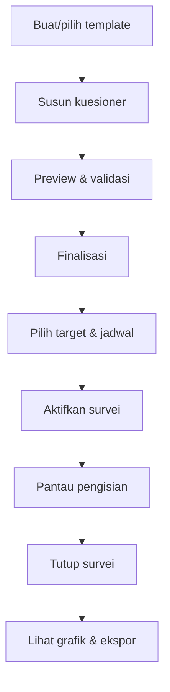

# Product Requirements Document (PRD)
## myAMETA Survey

**Versi:** 1.0  
**Tanggal:** 6 September 2026  
**Pemilik produk:** STIKES Advaita Medika / Tim myAMETA  
**Platform:** Web responsif, backend Laravel  
**Status:** Baseline pengembangan MVP  

---

## 1. Ringkasan Produk

myAMETA Survey adalah aplikasi survei terpusat untuk perguruan tinggi. Aplikasi digunakan untuk membuat dan menyebarkan kuesioner, mengelola data mahasiswa dan pegawai sebagai calon responden, memantau pengisian, serta menyajikan hasil dalam bentuk jumlah, persentase, tabel, dan diagram grafik.

Produk tidak mencakup PPEPP, temuan mutu, rencana tindak lanjut, PIC perbaikan, evidence, maupun verifikasi tindak lanjut pada versi ini. Batas proses produk adalah **hasil analisis dan ekspor laporan survei**.

Struktur utama aplikasi terdiri dari lima menu admin:

1. Kuesioner;
2. Data Mahasiswa;
3. Data Pegawai;
4. Hasil Analisa Kuesioner;
5. Pengaturan, dengan fungsi utama impor template kuesioner.

Sisi responden tidak menggunakan lima menu admin. Mahasiswa atau pegawai masuk melalui SSO, melihat daftar survei yang ditujukan kepadanya, mengisi, menyimpan draft bila diizinkan, dan melihat status pengisian.

---

## 2. Latar Belakang dan Masalah

Perguruan tinggi telah menggunakan Google Forms, formulir manual, atau fitur survei terpisah. Masalah yang masih terjadi:

- kuesioner tersebar dan sulit ditelusuri;
- pertanyaan serta skala tidak konsisten;
- data mahasiswa/pegawai diminta ulang;
- penyebaran dan reminder dilakukan manual;
- sulit mengetahui siapa yang belum atau sudah mengisi;
- data harus dibersihkan dan dihitung ulang di Excel;
- grafik dan laporan harus dibuat manual;
- perubahan pertanyaan ketika survei berjalan dapat merusak hasil;
- hasil antarprodi, angkatan, atau unit sulit dibandingkan;
- responden khawatir jawaban dapat dikaitkan dengan identitasnya;
- lonjakan login pada waktu yang sama berisiko memperlambat sistem.

myAMETA Survey menyelesaikan masalah tersebut melalui integrasi identitas, builder terstruktur, distribusi terarah, tracking, anonimitas terverifikasi, dan analitik otomatis.

---

## 3. Visi dan Proposisi Nilai

### 3.1 Visi

Menjadi pusat pengelolaan seluruh proses survei kampus, mulai dari pembuatan kuesioner hingga penyajian hasil analisis yang siap digunakan.

### 3.2 Proposisi nilai

- **Untuk pengelola:** satu tempat untuk membuat, mendistribusikan, memantau, dan menganalisis survei.
- **Untuk mahasiswa/pegawai:** pengisian mudah, mobile-friendly, identitas tidak perlu diketik ulang, dan mode kerahasiaan dijelaskan.
- **Untuk pimpinan:** hasil dapat dibaca melalui grafik, persentase, filter, dan perbandingan tanpa mengolah Excel secara manual.
- **Untuk tim IT:** terintegrasi Portal Hub, menggunakan Laravel, dapat dioperasikan pada satu server, dan memiliki desain ketahanan lonjakan akses.

---

## 4. Tujuan Produk

| ID | Tujuan | Indikator keberhasilan awal |
|---|---|---|
| PRD-G01 | Memusatkan proses survei | seluruh survei pilot dibuat dan dijalankan di aplikasi |
| PRD-G02 | Mengurangi pekerjaan manual | hasil persentase/grafik tersedia otomatis setelah respons masuk |
| PRD-G03 | Menargetkan responden secara tepat | target dapat ditentukan dari data mahasiswa/pegawai |
| PRD-G04 | Menjaga integritas hasil | struktur aktif terkunci dan submit idempotent |
| PRD-G05 | Menjaga kepercayaan responden | tersedia mode teridentifikasi dan anonim terverifikasi |
| PRD-G06 | Mendukung keputusan berbasis segmentasi | hasil dapat difilter per prodi, angkatan, unit, dan jenis responden |
| PRD-G07 | Bertahan saat akses serentak | lulus uji minimal 500 sesi aktif tanpa load balancer sesuai NFR |

Target final ditetapkan setelah baseline pilot dan pengujian infrastruktur nyata.

---

## 5. Non-Goals

Fitur berikut tidak menjadi sasaran versi awal:

- PPEPP dan manajemen standar mutu;
- temuan, akar masalah, RTL, PIC, tenggat, evidence, dan verifikasi;
- helpdesk, pengaduan, atau whistleblowing;
- evaluasi berbasis AI dan analisis sentimen otomatis;
- aplikasi mobile native;
- load balancing atau multi-application-node;
- benchmark lintas perguruan tinggi;
- marketplace template publik;
- pemberian sanksi/ranking otomatis kepada individu;
- pengolahan statistik lanjutan seperti factor analysis di dalam aplikasi.

---

## 6. Pengguna dan Persona

### 6.1 Admin Institusi/LPM

Membuat kuesioner, memilih target, mengaktifkan/menutup survei, memantau respons, dan membuka seluruh hasil agregat sesuai kewenangan.

### 6.2 Operator Survei

Menjalankan pekerjaan operasional survei. Haknya dapat dibatasi pada membuat draft, mengelola target, dan memantau pengisian tanpa mengubah pengaturan sensitif.

### 6.3 Pimpinan/Viewer

Melihat dashboard serta mengunduh laporan, tetapi tidak mengubah kuesioner atau data responden.

### 6.4 Administrator Teknis

Mengelola integrasi, sinkronisasi, role, log operasional, dan kesehatan sistem. Tidak otomatis memiliki akses ke jawaban sensitif.

### 6.5 Mahasiswa

Masuk melalui Portal Hub/SSO, melihat survei aktif yang sesuai, mengisi melalui ponsel/laptop, dan mengetahui apakah sudah selesai.

### 6.6 Pegawai

Dosen atau tenaga kependidikan yang mengisi survei sesuai unit, status, atau kelompok target.

---

## 7. Jobs to Be Done

| ID | Ketika | Pengguna ingin | Sehingga |
|---|---|---|---|
| JTBD-01 | akan menjalankan survei | membuat dari template atau nol | penyusunan lebih cepat dan konsisten |
| JTBD-02 | kuesioner selesai | memeriksa dan menguncinya | struktur tidak berubah ketika jawaban masuk |
| JTBD-03 | memilih responden | memfilter data mahasiswa/pegawai | survei hanya diterima kelompok relevan |
| JTBD-04 | survei aktif | melihat progres pengisian | reminder dan keputusan penutupan tepat |
| JTBD-05 | menerima undangan | login dan langsung mengisi | tidak membuat akun/mengetik identitas ulang |
| JTBD-06 | respons terkumpul | melihat persentase dan grafik otomatis | tidak mengolah data secara manual |
| JTBD-07 | meninjau unit/prodi | menggunakan filter dan perbandingan | masalah antarsegmen terlihat |
| JTBD-08 | membutuhkan bukti rapat/laporan | mengekspor hasil | hasil dapat dibagikan dan diarsipkan |

---

## 8. Prinsip Produk

1. **Survey-first:** semua fitur mendukung pembuatan hingga analisis survei.
2. **Sederhana bagi responden:** mobile-first, singkat, jelas, dan progres terlihat.
3. **Data master tidak diketik ulang:** identitas berasal dari Portal Hub/sistem sumber.
4. **Satu respons yang konsisten:** duplikasi dicegah sesuai mode survei.
5. **Versi tidak berubah:** kuesioner yang aktif tidak dapat diedit.
6. **Persentase transparan:** denominator, jumlah jawaban valid, dan pengecualian ditampilkan.
7. **Privasi jujur:** aplikasi tidak menyebut anonim jika identitas masih terlihat pada jawaban.
8. **Tidak hanya rata-rata:** tampilkan distribusi dan ukuran sampel.
9. **Proses berat asynchronous:** email, impor, ekspor, dan agregasi besar tidak menahan request pengguna.
10. **Single-server resilient:** ketahanan dicapai tanpa load balancing pada fase awal.

---

## 9. Struktur Navigasi

### 9.1 Menu Kuesioner

Subfitur:

- daftar kuesioner;
- tab Draft, Siap Disebarkan, Aktif, dan Ditutup;
- buat kuesioner;
- pilih template;
- builder;
- preview;
- duplikasi;
- finalisasi;
- target responden;
- jadwal dan kanal;
- aktifkan, jeda, tutup;
- monitoring pengisian;
- detail dan histori versi.

### 9.2 Menu Data Mahasiswa

- daftar mahasiswa;
- pencarian NIM/nama;
- filter status, prodi, jenjang, angkatan, dan tahun masuk;
- detail ringkas;
- status sinkronisasi;
- sinkron sekarang sesuai kewenangan;
- impor/manual fallback bila diaktifkan;
- ekspor daftar sesuai hak akses;
- jumlah data aktif, tidak aktif, dan gagal sinkron.

### 9.3 Menu Data Pegawai

- daftar dosen dan tenaga kependidikan;
- pencarian NIP/kode/nama;
- filter jenis pegawai, unit, jabatan, dan status;
- detail ringkas;
- status sinkronisasi;
- sinkron sekarang sesuai kewenangan;
- impor/manual fallback bila diaktifkan;
- ekspor sesuai hak akses.

### 9.4 Menu Hasil Analisa Kuesioner

- daftar survei yang memiliki respons;
- ringkasan jumlah target, mulai, selesai, dan response rate;
- grafik per pertanyaan;
- persentase per pilihan;
- rata-rata/skor untuk pertanyaan numerik atau skala;
- filter mahasiswa/pegawai, prodi, angkatan, unit, dan periode;
- perbandingan segmen;
- daftar jawaban teks sesuai kewenangan;
- unduh PNG grafik;
- ekspor XLSX/CSV/PDF;
- cetak ringkasan.

### 9.5 Menu Pengaturan

Ruang lingkup UI versi awal difokuskan pada **Impor Template Kuesioner**:

- unduh contoh format template;
- unggah XLSX atau JSON;
- validasi struktur;
- preview hasil impor;
- tampilkan error per baris/field;
- konfirmasi penyimpanan;
- histori impor;
- aktif/nonaktif template;
- hapus template yang belum digunakan;
- ekspor template sebagai cadangan.

Konfigurasi teknis lain dikelola melalui environment/configuration dan tidak perlu menjadi menu bisnis.

---

## 10. Alur Produk Utama

### 10.1 Alur admin

### 10.2 Alur responden

1. Pengguna membuka aplikasi dari Portal Hub atau tautan undangan.
2. SSO memverifikasi akun dan role.
3. Sistem menggunakan data lokal hasil sinkronisasi, bukan memanggil API master untuk setiap login.
4. Pengguna melihat daftar survei aktif dan statusnya.
5. Pengguna membuka halaman informasi survei: tujuan, periode, estimasi durasi, dan mode identitas.
6. Pengguna mengisi section dan pertanyaan yang relevan.
7. Sistem melakukan autosave bila fitur draft aktif.
8. Pengguna meninjau jawaban dan menekan Kirim.
9. Sistem memproses submit secara idempotent.
10. Status berubah menjadi Selesai dan kuesioner tidak dapat diisi ulang kecuali admin membuka kesempatan baru.

---

## 11. Lifecycle Kuesioner

| Status | Dapat diedit | Dapat menerima jawaban | Aksi utama |
|---|---:|---:|---|
| Draft | ya | tidak | edit, preview, hapus, duplikasi |
| Siap Disebarkan | terbatas | tidak | pilih target/jadwal, kembali ke Draft jika belum aktif |
| Aktif | tidak | ya | pantau, reminder, jeda, tutup |
| Dijeda | tidak | tidak sementara | aktifkan kembali atau tutup |
| Ditutup | tidak | tidak | lihat hasil, ekspor, duplikasi |

Perubahan struktur setelah aktif harus dilakukan dengan menduplikasi menjadi kuesioner baru. Respons lama tetap terikat pada struktur snapshot lama.

---

## 12. Kebutuhan Fitur Produk

### 12.1 Kuesioner dan builder

| ID | Kebutuhan | Prioritas |
|---|---|---|
| PRD-Q01 | membuat kuesioner kosong atau dari template | Must |
| PRD-Q02 | menyimpan judul, deskripsi, kategori, periode, tujuan, dan estimasi durasi | Must |
| PRD-Q03 | membuat section dan mengatur urutannya | Must |
| PRD-Q04 | menambah, mengubah, menduplikasi, menghapus, dan mengurutkan pertanyaan | Must |
| PRD-Q05 | mendukung teks pendek/panjang, single choice, multiple choice, dropdown, skala, matriks, angka, dan tanggal | Must |
| PRD-Q06 | mengatur wajib/opsional dan opsi Tidak Relevan | Must |
| PRD-Q07 | section branching berdasarkan jawaban | Must |
| PRD-Q08 | preview desktop/mobile dan seluruh jalur branching | Must |
| PRD-Q09 | validasi pertanyaan tanpa opsi, kode duplikat, dan section tidak terjangkau | Must |
| PRD-Q10 | finalisasi mengunci struktur | Must |
| PRD-Q11 | duplikasi kuesioner tanpa respons | Must |
| PRD-Q12 | autosave builder dan conflict warning | Should |
| PRD-Q13 | test response terpisah dari respons produksi | Should |

### 12.2 Data mahasiswa dan pegawai

| ID | Kebutuhan | Prioritas |
|---|---|---|
| PRD-D01 | sinkron data mahasiswa dari Portal Hub/API sumber | Must |
| PRD-D02 | sinkron data pegawai dari Portal Hub/API sumber | Must |
| PRD-D03 | incremental sync dan log keberhasilan/kegagalan | Must |
| PRD-D04 | pencarian, filter, pagination, dan jumlah data | Must |
| PRD-D05 | menandai sumber dan waktu sinkron terakhir | Must |
| PRD-D06 | data yang tidak ditemukan tidak langsung dihapus saat satu sync gagal | Must |
| PRD-D07 | impor XLSX fallback dengan validasi | Should |
| PRD-D08 | ekspor daftar sesuai kewenangan | Should |

### 12.3 Target dan distribusi

| ID | Kebutuhan | Prioritas |
|---|---|---|
| PRD-C01 | target mahasiswa, pegawai, atau keduanya | Must |
| PRD-C02 | filter target berdasarkan atribut relevan | Must |
| PRD-C03 | menampilkan preview jumlah eligible sebelum aktivasi | Must |
| PRD-C04 | menyimpan snapshot target ketika survei aktif | Must |
| PRD-C05 | distribusi melalui task Portal Hub dan tautan unik | Must |
| PRD-C06 | email undangan/reminder melalui queue | Should |
| PRD-C07 | public link/QR untuk survei terbuka | Should |
| PRD-C08 | reminder hanya untuk yang belum selesai | Must |
| PRD-C09 | pengaturan tanggal mulai/selesai dan timezone | Must |
| PRD-C10 | jeda dan tutup manual | Must |

### 12.4 Pengisian

| ID | Kebutuhan | Prioritas |
|---|---|---|
| PRD-R01 | login SSO dan daftar survei eligible | Must |
| PRD-R02 | mode identified dan verified anonymous | Must |
| PRD-R03 | mobile responsive dan keyboard accessible | Must |
| PRD-R04 | progres section dan validasi yang jelas | Must |
| PRD-R05 | branching sesuai jawaban | Must |
| PRD-R06 | autosave/save draft | Should |
| PRD-R07 | review jawaban sebelum submit | Should |
| PRD-R08 | submit idempotent dan bukti status selesai | Must |
| PRD-R09 | mencegah respons kedua untuk eligibility yang sama | Must |
| PRD-R10 | pesan khusus saat belum mulai, dijeda, berakhir, atau tidak eligible | Must |

### 12.5 Hasil analisa

| ID | Kebutuhan | Prioritas |
|---|---|---|
| PRD-A01 | response funnel dan response rate | Must |
| PRD-A02 | jumlah dan persentase tiap pilihan | Must |
| PRD-A03 | grafik otomatis sesuai tipe pertanyaan | Must |
| PRD-A04 | nilai mean/median untuk skala/angka | Must |
| PRD-A05 | filter prodi, angkatan, unit, jenis responden, dan periode | Must |
| PRD-A06 | jumlah `n` dan denominator ditampilkan | Must |
| PRD-A07 | Tidak Relevan dikeluarkan dari denominator skor | Must |
| PRD-A08 | perbandingan segmen dan antarperiode kompatibel | Should |
| PRD-A09 | komentar teks dengan pagination dan pencarian | Must |
| PRD-A10 | threshold penyembunyian kelompok kecil | Must |
| PRD-A11 | ekspor XLSX/CSV/PDF dan grafik PNG | Must |
| PRD-A12 | proses ekspor besar melalui queue | Must |

### 12.6 Impor template

| ID | Kebutuhan | Prioritas |
|---|---|---|
| PRD-T01 | menyediakan contoh XLSX | Must |
| PRD-T02 | impor XLSX dan JSON | Must |
| PRD-T03 | validasi schema, tipe, kode, section, opsi, dan logic | Must |
| PRD-T04 | preview sebelum commit | Must |
| PRD-T05 | transaksi all-or-nothing | Must |
| PRD-T06 | error report per sheet/baris/kolom | Must |
| PRD-T07 | histori impor dan identitas pengimpor | Must |
| PRD-T08 | ekspor template | Should |

---

## 13. Model Analitik dan Grafik

| Tipe pertanyaan | Output default |
|---|---|
| Single choice/dropdown | jumlah, persentase, bar/donut |
| Multiple choice | jumlah responden per opsi, persentase responden, horizontal bar |
| Likert | distribusi per skala, mean, median, 100% stacked bar |
| Matrix | distribusi dan mean per baris, grouped/stacked bar atau heatmap |
| Angka | count, mean, median, min, max, histogram opsional |
| Tanggal | jumlah per periode/bucket bila relevan |
| Teks | daftar jawaban, count, pencarian; tanpa sentiment pada MVP |

Rumus pilihan tunggal:

\[
Persentase\ Opsi = \frac{Jumlah\ jawaban\ pada\ opsi}{Total\ jawaban\ valid\ pertanyaan} \times 100\%
\]

Rumus multiple choice menggunakan jumlah responden yang memilih opsi dibagi jumlah responden valid; total persentase dapat melebihi 100% dan UI wajib menjelaskannya.

Rumus response rate:

\[
Response\ Rate = \frac{Respons\ selesai}{Responden\ eligible\ yang\ diundang} \times 100\%
\]

Jawaban kosong, tidak valid, dan `Tidak Relevan` dipisahkan. Sistem tidak boleh mengubah denominator tanpa penjelasan.

---

## 14. Privasi dan Akses

- Identified: respons menyimpan hubungan ke responden dan labelnya terlihat jelas sebelum pengisian.
- Verified anonymous: sistem mengetahui eligibility dan completion, tetapi payload respons tidak memiliki hubungan langsung ke `student_id`/`employee_id`.
- Agar hasil anonim tetap dapat difilter, respons hanya membawa snapshot atribut kategorikal yang diizinkan seperti prodi, angkatan, jenis responden, atau unit; NIM, NIP, nama, email, dan identifier unik tidak ikut disalin.
- Hasil segmen di bawah threshold default lima respons disembunyikan.
- Komentar pada survei anonim tidak menampilkan identitas.
- Akses raw export dibatasi role khusus dan diaudit.
- IP dan user-agent tidak digunakan sebagai identitas respons; penyimpanan untuk keamanan harus minimum dan memiliki retensi singkat.
- Pengguna diberi privacy notice sebelum mulai.

---

## 15. Persyaratan Kinerja Produk

Walaupun tidak memakai load balancing, produk harus dirancang untuk lonjakan akses mahasiswa.

Baseline validasi:

- minimal 500 sesi login/aktif bersamaan pada satu application server;
- skenario 300 login SSO callback dalam 60 detik;
- skenario 200 pengguna membuka kuesioner secara bersamaan;
- skenario 100 submit hampir bersamaan tanpa duplikasi;
- error rate aplikasi di bawah 1% pada beban target;
- P95 endpoint aplikasi non-ekspor maksimal 1,5 detik pada beban target, di luar waktu respons IdP eksternal;
- submit diterima maksimal 2 detik P95 dan pekerjaan turunannya masuk queue;
- dashboard agregat umum maksimal 3 detik P95 dengan cache/pre-aggregation;
- ekspor besar tidak dilakukan synchronously.

Angka harus diuji ulang terhadap spesifikasi server produksi dan volume data aktual. Ketahanan dicapai melalui tuning aplikasi, Redis, PHP-FPM/OPcache, query/index yang tepat, connection pooling PostgreSQL, cache, queue, dan pre-synchronization—tanpa load balancer.

---

## 16. Product Analytics

Event minimum:

- login_started, login_succeeded, login_failed;
- survey_list_viewed;
- survey_opened;
- response_draft_saved;
- section_completed;
- response_submitted;
- validation_failed;
- campaign_activated/paused/closed;
- invitation_sent/delivered/failed;
- analysis_viewed;
- filter_applied;
- export_requested/completed/failed;
- template_import_started/validated/committed/failed;
- sync_started/completed/failed.

Event tidak boleh memuat isi jawaban sensitif.

---

## 17. Success Metrics

### Adopsi

- persentase survei pilot yang sepenuhnya diproses di aplikasi;
- jumlah kuesioner dibuat dari template;
- persentase responden membuka dan menyelesaikan survei;
- median waktu pengisian.

### Efisiensi

- waktu pembuatan kuesioner;
- waktu dari penutupan sampai hasil tersedia;
- penurunan pekerjaan manual Excel/grafik;
- tingkat keberhasilan sinkronisasi dan pengiriman.

### Kualitas

- drop-off per section;
- validation error rate;
- duplicate submit yang berhasil dicegah;
- persentase hasil dengan denominator dan `n` yang benar;
- jumlah insiden akses tidak sah atau kebocoran identitas: target nol.

### Keandalan

- uptime selama periode survei;
- P95 response time;
- error rate saat peak;
- queue backlog dan waktu penyelesaian ekspor;
- recovery time setelah gangguan.

---

## 18. Tahapan Rilis

### Release 1 — Core MVP

- lima menu;
- SSO dan sync data;
- builder dasar dan template;
- target/snapshot;
- pengisian;
- monitoring;
- persentase, grafik, filter;
- ekspor;
- import template;
- audit dan performance hardening.

### Release 1.1

- autosave responden dan builder;
- email reminder;
- perbandingan antarperiode;
- ekspor template;
- peningkatan chart dan PDF.

### Release 2

- public QR survey;
- EDOM/kelas;
- tracer study lebih lengkap;
- integrasi tambahan;
- statistik lanjutan sesuai kebutuhan terverifikasi.

PPEPP tetap merupakan produk/phase terpisah dan tidak otomatis masuk Release 2.

---

## 19. Risiko Produk dan Mitigasi

| Risiko | Mitigasi |
|---|---|
| Scope kembali membesar | kunci non-goals dan change control |
| Login burst membebani server | local roster, Redis session/cache, tuned PHP-FPM, pooling, load test |
| API Portal Hub lambat | jangan panggil pada setiap login; sync terjadwal dan fallback cache |
| Struktur berubah setelah respons | lock setelah aktivasi dan duplicate-as-new |
| Persentase salah | definisi denominator, automated test, dan tampilkan `n` |
| Jawaban ganda | unique eligibility, idempotency key, DB constraint |
| Anonimitas palsu | pemisahan data dan review arsitektur |
| Import template merusak data | preview dan transaksi all-or-nothing |
| Export membebani server | queue, batas ukuran, expiry file |
| Grafik menyesatkan | chart sesuai tipe, skala konsisten, label `n`/filter |
| Data master tidak akurat | sync log, reconciliation, last synced status |

---

## 20. Dependensi dan Asumsi

- Portal Hub menyediakan OIDC/OAuth2 atau mekanisme SSO yang aman.
- Portal Hub/API sumber menyediakan identifier stabil mahasiswa dan pegawai.
- Struktur prodi/unit dan status aktif tersedia atau dapat dipetakan.
- SMTP tersedia jika email diaktifkan.
- Server menyediakan PHP, Laravel, PostgreSQL, Redis, queue worker, dan scheduler.
- Seluruh waktu disimpan UTC dan ditampilkan sesuai timezone institusi.
- Spesifikasi server final akan menentukan hasil kapasitas aktual.
- Pengguna admin menyepakati format template XLSX.

---

## 21. Acceptance Criteria Produk

Produk Release 1 diterima jika:

1. Lima menu final tersedia sesuai kewenangan.
2. Admin dapat membuat, mem-preview, memfinalisasi, menargetkan, mengaktifkan, memantau, menutup, dan menganalisis kuesioner.
3. Mahasiswa dan pegawai dapat login melalui SSO serta hanya melihat survei eligible.
4. Data mahasiswa/pegawai dapat disinkronkan dan kegagalannya dapat dilihat tanpa menghapus data massal.
5. Seluruh tipe pertanyaan MVP dan section branching bekerja.
6. Struktur kuesioner aktif tidak dapat diedit.
7. Satu eligibility tidak menghasilkan lebih dari satu respons final.
8. Mode verified anonymous tidak memiliki relasi langsung dari respons ke identitas.
9. Jumlah, persentase, denominator, `n`, dan grafik sesuai data uji.
10. Filter hasil tidak membocorkan segmen di bawah threshold.
11. XLSX/CSV/PDF dan PNG dapat dihasilkan; ekspor besar melalui queue.
12. Impor template menampilkan preview/error dan tidak menyimpan data parsial.
13. Sistem lulus skenario kapasitas yang ditetapkan tanpa load balancing.
14. Audit log tersedia untuk aksi sensitif.
15. UAT admin, mahasiswa, pegawai, pimpinan, dan IT ditandatangani.

---

## 22. Keputusan yang Perlu Dikonfirmasi Saat Kickoff

- nama resmi aplikasi dan domain;
- satu kampus atau multi-tenant sejak awal;
- detail SSO dan klaim identitas;
- endpoint serta jadwal sinkronisasi;
- format identifier pegawai;
- target mahasiswa/pegawai pada campaign gabungan;
- apakah public link/QR masuk Release 1;
- mode default survei;
- threshold minimum hasil;
- template awal yang wajib tersedia;
- format XLSX impor template;
- spesifikasi server produksi;
- role yang boleh melihat raw export dan komentar;
- branding PDF dan grafik;
- periode retensi respons dan file ekspor.
